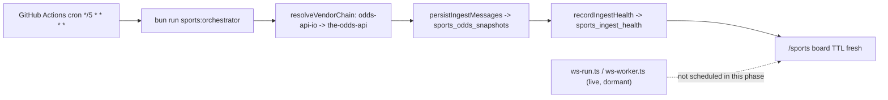
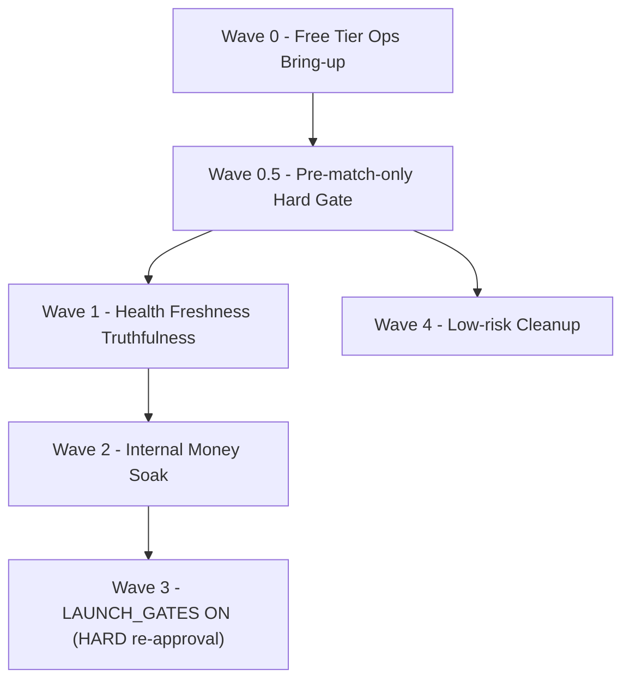

# PLAN — Sports Pre-match Free Tier Waves (사전 배당 무료 티어 완결 로드맵)

> **작성 세션:** 문서 작성 전용 (코드/migration/CI/워크플로 변경 0)
> **선행 Plan:** Cursor Plan `스포츠_무료_실배당_완결_로드맵_7e4363d6` — 본 문서가 operator의 4대 확정 결정(사전 배당 전용·라이브 코드 보존·무료 티어·Wave 3 재승인)을 반영해 **대체·정본화**한다.
> **핵심 선언:** 실시간(라이브) 배당 관련 기존 코드·모듈·타입·테스트는 **삭제하지 않는다.** 나중에 유료 전환 시 즉시 재활성화할 수 있도록 feature flag로 잠들여(dormant) 보존한다. 본 Plan은 **사전 배당(pre-match) 경로만** 활성화한다.

## 0. Metadata

| 필드 | 값 |
| --- | --- |
| **문서 버전** | `1.0.0` |
| **작성일** | 2026-07-14 |
| **승인 상태** | **DRAFT — operator 확인 대기.** Wave 0~2는 본 문서 승인만으로 착수 가능(§9). **Wave 3(LAUNCH_GATES ON)은 이 승인과 별개로 그 시점에 operator의 명시적 재승인 명령이 반드시 필요**하다 — 비협상. |
| **전체 Risk** | **Medium** (Wave 1/2는 additive money-adjacent migration · Wave 3만 High이며 별도 게이트) |
| **Wave 수** | **5 (Wave 0 · 0.5 · 1 · 2 · 3 · 4 — 표기상 6개 섹션)** |
| **현재 단계 범위** | **Pre-match(사전 배당)만.** 라이브(인플레이) 배당·베팅은 이번 단계에서 **활성화하지 않음** — 기존 라이브 코드는 의도적으로 보존되어 향후 유료 티어 전환 시 flag 하나로 켤 수 있다. |
| **근거 원본** | 이전 세션 SQL 증거 덤프(원격 `yocjhjsdwoijfdrehzoq` 실측) · [`SPORTS_ODDS_INGEST_RUNBOOK.md`](OPERATIONS/SPORTS_ODDS_INGEST_RUNBOOK.md) · Cursor Plan `스포츠_무료_실배당_완결_로드맵_7e4363d6` |
| **정본 vs 본 문서 관계** | 본 문서는 **스포츠 Pre-match Free Tier 실행 정본**이다. 라이브/유료 전환 로드맵은 본 문서 범위 밖 — 별도 후속 Plan(§6 참조)에서 다룬다. |

## 1. Non-negotiables (전 Wave 공통)

1. **Pre-match only (현 단계 절대 원칙):** 이번 단계에서 사용자에게 노출·정산되는 배당·베팅은 경기 시작 전(pre-match) 마켓으로 한정한다. 라이브(인플레이) 배당·베팅은 명시적으로 비활성 상태를 유지한다.
2. **라이브 코드 보존 원칙 (절대 삭제 금지):** `rpc_place_sports_bet`의 `v_is_live` 분기, `_sports_live_acceptance_delay`, `_sports_any_live_leg`, `_sports_odds_max_age_for_fixture`, `wave_s7_sportsbook_inplay_engine.sql`의 `rpc_get_live_fixture_state` / `rpc_ingest_sports_fixture_status` / `rpc_transition_fixture_live`, `sports_live_ttl_by_sport` 테이블, WS ingest(`scripts/sports-odds-ingest/ws-run.ts` · `ws-worker.ts` · `packages/sports-ingest/src/odds-api-io-ws.ts` · `ws-stall-detector.ts`) — 이들 중 **어느 것도 이번 Plan에서 삭제·주석 처리·시그니처 변경하지 않는다.** 추가만 허용(guard/feature flag 삽입), 제거는 금지.
3. **무료 티어 ToS 정직성:** odds-api.io·The Odds API 무료 티어의 실제 한도와 이용조건 제약을 문서에 명시하고, 위반 소지가 있는 지점(상업적 프로덕션 사용 제한)을 숨기지 않는다.
4. **Money 안전:** `@phonara/money`/Decimal 전용, 클라이언트 재계산 0, 원장 append-only(`30-money-ledger.mdc`) — Wave 1/2/4가 건드리는 함수도 이 원칙을 벗어나지 않는다.
5. **G13 준수:** SQL/E2E/`check:full`은 GitHub CI가 authoritative — 에이전트 로컬 heavy gate 직접 실행 금지.
6. **원격 apply 정본:** migration 반영은 `bun run stack:push-remote`만 — `supabase db push`/`supabase link` 수동 금지.
7. **Engine Freeze 준수:** `docs/SSOT/ACTIVE_WORK_SSOT.md` 상 Engine Apex `FULLY CLOSED` — 본 Plan의 SQL 변경은 "버그 수정·승인된 예외"로 한정되는 최소 additive guard이며, 신규 엔진 기능 확장이 아니다.
8. **테스트 삭제 0:** 기존 vitest/SQL 테스트 파일을 삭제하지 않는다. 필요한 신규 케이스는 기존 파일에 추가한다.
9. **중복 생성 금지:** 착수 전 `git status` + Grep/Glob로 동일 목적 파일이 이미 있는지 확인 — parallel ingest 스크립트·워크플로·RPC 생성 금지.
10. **Wave 3 하드 체크포인트:** LAUNCH_GATES(`sportsBetting`/`sportsCashout`)를 `true`로 바꾸는 커밋은 이 문서 승인만으로 실행하지 않는다 — 그 시점에 operator의 별도 명시적 재승인 문구가 필요하다.

## 2. Current State Snapshot (원격 실측 근거)

- `sports_odds_snapshots`: 1,052행, 최신 `captured_at` = 2026-06-16 04:43 UTC, TTL(사전 300s/라이브 15s) 내 최신 오즈 **0/337** — 배당 파이프라인 사실상 정지.
- `sports_ingest_health`: 3채널(`orchestrator`/`rest`/`settle`) 전부 `status=healthy`이지만 `last_success_at` 기준 경과 **~662시간** — 문자열이 재평가되지 않아 거짓 healthy로 남아 있음.
- `cron.job`: 21개 중 sports ingest 관련 **0개** — DB 스케줄러 경로 없음. Node 워커(`scripts/sports-odds-ingest/*`, `scripts/sports-orchestrator/*`)가 유일한 실행 경로이며 상시 가동 인프라가 없다.
- `sports_bets`/`sports_bet_legs`/`sports_risk_events`/`sports_device_signals`/`sports_score_quorum_events`: 전부 **0행** — 프로덕션 실베팅 이력 없음.
- `sports_fixtures.status`: `scheduled` 96 · `finished` 12 · **`live` 0** — 현재 데이터상 라이브 경기 자체가 없어 "사전 배당만" 상태가 자연스럽게 유지되고 있으나, 코드 레벨의 하드 가드는 아직 없다(`rpc_place_sports_bet`이 `fixture.status IN ('scheduled','live')`를 그대로 허용).
- `LAUNCH_GATES.sportsBetting = false` · `sportsCashout = false` (기본값, [`launch-gates.ts`](../apps/web/src/lib/launch-gates.ts)) — 코드 기본 fail-closed 유지 중.
- `app_config.sports_ingest_enabled = 'true'`이지만 실제 ingest 프로세스가 어디서도 상시 실행되지 않음 — 플래그와 실제 운영 상태가 불일치.
- 벤더 구현 상태: `the-odds-api`(REST, 완전 구현) · `odds-api-io`(REST 완전 구현 + WS는 별도 파일로 존재하되 미가동) · `sportsgameodds`(REST 구현, 미선택) — [`vendor-chain.ts`](../packages/sports-ingest/src/vendor-chain.ts) `resolveVendorChain`가 auto-failover 지원.

## 3. Architecture Decision

### 3.1 Pre-match-first 전략

지금 단계는 "화면에 살아있는 것처럼 보이는 사전 배당 보드"를 무료 인프라로 완성하는 데 집중한다. 라이브 베팅은 코드가 이미 존재하지만(§1.2) **의도적으로 잠들여 둔다** — 데이터가 없어서 자연히 꺼져 있는 상태(현재)에서, 데이터가 생기더라도(향후 라이브 fixture가 ingest되더라도) 코드가 하드하게 막아주는 상태(Wave 0.5 이후)로 강화한다.

### 3.2 라이브 코드 보존 방식 — Feature Flag Dormant Path

- 신규 config 키 `feature_sports_live_betting_enabled`를 `app_config`에 **명시적으로 `'false'`로 시딩**한다. 주의: 기존 `_assert_feature_enabled(p_feature TEXT)`([`p0_feature_kill_switches.sql`](../supabase/migrations/20260609000019_p0_feature_kill_switches.sql) L41-56)는 **"명시적으로 'false'일 때만 차단, 키가 없으면 기본 허용"**하는 fail-open 설계다. 따라서 키를 심지 않고 함수만 호출하면 즉시 라이브가 열려버리는 함정이 있다 — Wave 0.5 migration은 **가드 함수 삽입과 config row 시딩을 반드시 같은 트랜잭션(같은 migration 파일)**에서 처리한다.
- `rpc_place_sports_bet`의 라이브 분기(`IF v_is_live ... ELSE ... END IF`, 최신 정의는 [`pir_idempotency_handlers.sql`](../supabase/migrations/20260730000001_pir_idempotency_handlers.sql) L794 부근)에 `PERFORM _assert_feature_enabled('sports_live_betting');`를 `v_is_live = TRUE`일 때만 추가한다 — 사전 배당 분기는 완전히 무영향.
- `rpc_place_sports_system_bet`([`wave_s16_s22_sportsbook_world_engine.sql`](../supabase/migrations/20260616000111_wave_s16_s22_sportsbook_world_engine.sql))도 동일 라이브 분기가 있는지 확인 후 대칭 가드를 추가한다.
- WS 실시간 ingest 경로(`ws-run.ts`/`ws-worker.ts`/`odds-api-io-ws.ts`/`ws-stall-detector.ts`)는 **호출하지 않는 것만으로** 비활성화된다 — 파일은 그대로 두고, Wave 0의 GitHub Actions 워크플로는 REST 엔드포인트(`sports:orchestrator` 또는 `sports:ingest`)만 스케줄한다. 코드 삭제·비활성 주석 불필요.
- `wave_s7_sportsbook_inplay_engine.sql`의 인플레이 함수들(`rpc_get_live_fixture_state` 등)과 `sports_live_ttl_by_sport` 테이블은 그대로 존재하되, 사전 배당만 ingest되는 한 자연히 사용되지 않는다 — 별도 조치 불필요, 유료 전환 시 그대로 재사용.

### 3.3 무료 티어 생존 설계 (polling · leagues · stale rules)

- 벤더 failover 순서: `SPORTS_ODDS_VENDOR_PRIORITY=odds-api-io,the-odds-api` (odds-api.io 1순위 — 시간당 100req 영구 무료, the-odds-api 백업 — 월 500크레딧). 기존 `resolveVendorChain` 그대로 사용, 코드 변경 0.
- 폴링 주기: GitHub Actions 5분 cron → 시간당 최대 12회 호출. odds-api.io 무료 한도(시간당 100)에 여유가 크고, the-odds-api 백업 경로는 실패 시에만 소진되므로 월 500크레딧을 아낄 수 있다.
- 리그 범위: `SPORTS_INGEST_LEAGUES=epl,k-league`(기존 기본값 유지) — 무료 한도 내 안정성 우선, 확장은 Wave 2 soak 이후 재검토.
- Stale 규율: 기존 [`sports-odds-freshness-display-contract.ts`](../apps/web/src/domain/sports-odds-freshness-display-contract.ts)의 TTL(사전 300초) 그대로 사용 — 신규 로직 불필요, ingest가 5분 주기로 살아나면 자연히 TTL을 통과한다.
- ToS 리스크 문서화: odds-api.io 무료 플랜은 "development/testing" 목적으로 명시되어 있고 "production·상업적 사용은 유료 전환 필요"라고 안내한다 — Wave 0~2(보드 살리기 + 내부 soak)는 이 리스크를 인지한 상태로 진행하고, **Wave 3(실유저 실머니 공개) 이전에 유료 플랜 전환 여부를 operator가 결정**하는 것을 하드 조건으로 명시한다(§4 Wave 3).

### 3.4 스케줄러 — GitHub Actions

- 신규 파일: `.github/workflows/sports-odds-ingest.yml` — 기존 [`.github/workflows/ci.yml`](../.github/workflows/ci.yml) 네이밍·스텝 관례를 따른다.
- Secrets(GitHub repo secrets, 커밋 금지): `ODDS_API_IO_KEY`, `THE_ODDS_API_KEY`, `SPORTS_ODDS_VENDOR_PRIORITY`, `SPORTS_INGEST_DRY_RUN=false`, `SPORTS_INGEST_LEAGUES`, Supabase service-role 접속 정보(기존 스크립트가 쓰는 것과 동일 키 재사용, 신규 키 발급 금지).
- GitHub Actions 무료 cron은 "정각 근처" 스케줄이며 큐 지연으로 수 분 늦어질 수 있음을 사용자에게 정직하게 고지 — 완전한 초단위 실시간이 아니라 "5분 단위로 신선해지는 사전 배당 보드" 수준이다.

## 4. Wave Structure

### Wave 0 — Free Tier Ops Bring-up (secrets + 신규 워크플로, 코드 최소)

- **Goal:** 무료 벤더 failover + GitHub Actions 스케줄러로 사전 배당을 상시 살린다.
- **Why:** §2 근거 — ingest 상시 실행 경로 0, odds 100% stale.
- **Severity / Risk:** Low(코드 변경 거의 없음, secrets/워크플로 설정 위주).
- **Scope In:** `.env`(로컬 테스트용)/GitHub Actions secrets 설정, 신규 워크플로 파일 1개, 수동 트리거 1회 검증.
- **Scope Out:** 라이브(WS) 워커 스케줄링 **절대 포함하지 않음** · DB 스키마 변경 · LAUNCH_GATES 변경.
- **Task checklist:**
  1. odds-api.io 무료 키 발급, `THE_ODDS_API_KEY`(백업)는 기존 계정 또는 신규 무료 가입.
  2. GitHub repo secrets에 §3.4 목록 등록.
  3. `.github/workflows/sports-odds-ingest.yml` 작성 — `schedule: cron: '*/5 * * * *'` + `workflow_dispatch` 수동 트리거 지원, 단일 스텝 `bun run sports:orchestrator`(REST 경로만).
  4. 수동 `workflow_dispatch` 1회 실행.
  5. 원격 SQL로 `sports_odds_snapshots` 최신 `captured_at`이 TTL 안에 들어오는지, `sports_ingest_health` 갱신 여부 확인(읽기 전용 검증).
- **Files:** `.github/workflows/sports-odds-ingest.yml`(신규), `.env.example`(문서화용 키 이름만 추가, 값 없음).
- **Safety:** dry-run 기본값을 유지한 채 1회 워크플로 문법 검증 → `SPORTS_INGEST_DRY_RUN=false` 전환은 문법 검증 통과 후.
- **Rollback:** 워크플로 파일 삭제 또는 `schedule` 트리거만 제거(코드 영향 없음) · secrets 회수.
- **Acceptance (binary):**
  - [ ] 워크플로가 5분 주기로 최소 6회 연속 성공(30분 관찰)
  - [ ] `sports_odds_snapshots` 최신 `captured_at`이 사전 TTL(300s) 안에 지속 유지
  - [ ] `sports_ingest_health` 3채널 `last_success_at`이 실시간에 근접
- **Required Verification:** 원격 SQL 읽기 전용 조회(에이전트 heavy gate 아님) · 워크플로 실행 로그.
- **Dependencies:** 없음 — 독립 착수 가능.
- **Commit Strategy:** 1 conventional commit — `ci(sports): add free-tier prematch odds ingest schedule`.

### Wave 0.5 — Pre-match-only Hard Gate (additive migration)

- **Goal:** 라이브 베팅을 "데이터가 없어서 안 열리는 상태"에서 "코드가 명시적으로 막는 상태"로 전환한다 — Core Decision #1/#4를 코드로 고정.
- **Why:** `rpc_place_sports_bet`이 현재 `fixture.status IN ('scheduled', 'live')`를 모두 허용하고 있어(§1.2 근거), 향후 ingest가 라이브 fixture를 실수로 만들어내면 즉시 라이브 베팅이 열릴 수 있다. Zero-ambiguity 요구사항상 이 경로를 명시적으로 닫아야 한다.
- **Severity / Risk:** Medium(money RPC 터치, 그러나 additive guard만 — 기존 분기 로직 변경 없음).
- **Scope In:** `feature_sports_live_betting_enabled` config 키 시딩(`'false'`) + `rpc_place_sports_bet`/`rpc_place_sports_system_bet`의 라이브 분기에 `PERFORM _assert_feature_enabled('sports_live_betting');` 추가.
- **Scope Out:** 라이브 분기 로직 삭제·수정 · `_sports_live_acceptance_delay`/`_sports_any_live_leg`/`wave_s7` 함수 변경 · WS ingest 코드 변경.
- **Task checklist:**
  1. RED-first: 로컬에서 라이브 fixture 시뮬레이션 → 현재 `rpc_place_sports_bet`이 막지 않음을 SQL 테스트로 재현.
  2. Additive migration: `INSERT INTO app_config (key, value) VALUES ('feature_sports_live_betting_enabled', 'false') ON CONFLICT DO NOTHING;` + `rpc_place_sports_bet`/`rpc_place_sports_system_bet` 라이브 분기에 가드 삽입(기존 `pg_get_functiondef` → `regexp_replace` 패치 관례 또는 전체 `CREATE OR REPLACE FUNCTION` 재정의 — 기존 함수 관례와 동일 방식 사용, 신규 함수 생성 금지).
  3. 기존 [`sportsbook_place_conservation_test.sql`](../supabase/tests/sportsbook_place_conservation_test.sql) 등에 "라이브 fixture + flag off → 거부" 케이스 추가(신규 파일 생성 금지, 기존 파일 확장).
  4. 로컬 `db reset` → `test:sql`(CI/`gate:local-autopilot` 경유) → green 확인 → `stack:push-remote` → advisor 0 ERROR.
- **Files:** 신규 migration(`supabase/migrations/<timestamp>_sports_prematch_only_hard_gate.sql`), `supabase/tests/sportsbook_place_conservation_test.sql`(확장).
- **Safety:** 사전 배당 분기는 완전히 무영향(가드가 `v_is_live=TRUE` 분기에만 존재) · fail-open 함정(§3.2) 문서화된 대로 config row와 가드를 같은 migration에서 원자적으로 반영.
- **Rollback:** 해당 migration만 revert하는 additive down-migration 준비(가드 제거 + config row 삭제) — 라이브 분기 자체는 원상 복구되어 이전과 동일하게 동작(단, 그 상태가 이번 Plan 착수 이전 상태와 같으므로 위험은 §1.2 원본 상태로 회귀하는 수준).
- **Acceptance (binary):**
  - [ ] `feature_sports_live_betting_enabled='false'` 시딩 확인
  - [ ] 라이브 fixture 대상 베팅 시도 → `feature_disabled` 에러로 거부(신규 SQL 테스트 green)
  - [ ] 사전(pre-match) fixture 베팅 흐름은 회귀 0(기존 conservation 테스트 green)
  - [ ] remote advisor 0 ERROR
- **Required Tests:** `sportsbook_place_conservation_test.sql`(확장) · CI `sql` job.
- **Dependencies:** Wave 0과 독립적으로 병행 가능(순서상 먼저 해도 무방).
- **Commit Strategy:** 1 conventional commit — `feat(sql): add pre-match-only hard gate for live sports bets (dormant flag)`.

### Wave 1 — Health Freshness Truthfulness

- **Goal:** `sports_ingest_health.status`가 시간이 지나도 재평가되지 않아 "662시간 전인데 healthy"로 남는 문제를 없앤다.
- **Why:** §2 근거 — 3채널 모두 거짓 healthy.
- **Severity / Risk:** Medium(읽기/쓰기 경로 수정, money 직접 관련 없음).
- **Scope In:** `rpc_record_sports_ingest_health` 또는 health 조회 경로에 freshness 재계산 추가 — `last_success_at`이 `sports_odds_snapshot_max_age_sec`/`sports_live_odds_max_age_sec` 기준을 넘으면 저장된 문자열이 아니라 계산된 상태(`stale`)를 반환.
- **Scope Out:** `IngestHealthStatus` enum 값 추가/변경(기존 `healthy|degraded|stale|error|disabled|skipped` 재사용) · 신규 컬럼 다수 추가.
- **Task checklist:**
  1. RED-first: "last_success 오래됐는데 healthy로 응답" 케이스를 [`sportsbook_ingest_health_test.sql`](../supabase/tests/sportsbook_ingest_health_test.sql)에 추가 → 현재 FAIL 확인.
  2. Additive migration으로 조회 경로(뷰 또는 함수)에 SLA 재계산 삽입.
  3. 위 SQL 테스트 green 확인 → `stack:push-remote` → advisor 0 ERROR.
- **Files:** 신규 migration, `supabase/tests/sportsbook_ingest_health_test.sql`(확장).
- **Safety:** 라이브/사전 배당 베팅 로직 미터치 — health 표시 계층만.
- **Rollback:** migration 단독 revert.
- **Acceptance (binary):**
  - [ ] stale 판정 SQL 테스트 green
  - [ ] Wave 0 워크플로 가동 중에는 `healthy` 정상 표시, 워크플로 중단 시 일정 시간 후 `stale`로 자동 전환
- **Required Tests:** `sportsbook_ingest_health_test.sql`.
- **Dependencies:** Wave 0 이후 권장(가동 중인 상태에서 검증이 더 명확).
- **Commit Strategy:** 1 commit — `fix(sql): recompute sports ingest health freshness on read`.

### Wave 2 — Internal Money Soak (내부 검증만, 실유저 노출 없음)

- **Goal:** 사전 배당 경로의 place → settle → void → cashout(PHON+USDT) 흐름이 실제로 자금 보존(Σ=0)을 지키는지 스테이징/로컬에서 증명한다.
- **Why:** §2 근거 — `sports_bets` 등 money 테이블 전부 0행, 실증 이력 없음.
- **Severity / Risk:** High(money 경로) — 그러나 **내부 스테이징 한정, 실유저 노출 없음**이라 LAUNCH_GATES는 여전히 false.
- **Scope In:** 기존 conservation SQL 테스트 재실행 + 필요 시 사전 배당(라이브 아님) 시나리오 케이스 보강.
- **Scope Out:** 라이브 시나리오 케이스(§1.2 원칙상 이번 단계에서 라이브 경로 실증은 하지 않음, Wave 0.5로 이미 차단됨) · LAUNCH_GATES 변경.
- **Task checklist:**
  1. [`sportsbook_place_conservation_test.sql`](../supabase/tests/sportsbook_place_conservation_test.sql) · `sportsbook_combo_conservation_test.sql` · `sportsbook_settle_conservation_test.sql` · `sportsbook_void_conservation_test.sql` · [`usdt_betting_proof_e7_test.sql`](../supabase/tests/usdt_betting_proof_e7_test.sql) 전부 CI `sql` job에서 green 재확인.
  2. Wave 0.5로 살아난 실제 사전 배당 데이터(스테이징)로 최소 1회 end-to-end 수동 흐름(place→settle) 실행, `sports_bets` 행 생성 확인.
- **Files:** 없음(기존 테스트 재확인 위주) 또는 위 파일들에 소규모 케이스 추가.
- **Safety:** 스테이징 전용 · 실유저 자금 미터치.
- **Rollback:** 불필요(검증 세션, 코드 변경 최소).
- **Acceptance (binary):**
  - [ ] 위 5개 SQL 테스트 전부 CI green
  - [ ] 스테이징 `sports_bets` count > 0, conservation Σ=0 확인
- **Required Tests:** 상기 conservation 테스트 5종.
- **Dependencies:** Wave 0.5(하드 게이트) 완료 후 착수 — 라이브 경로가 차단된 상태에서 soak해야 "사전 배당만 증명"이 성립.
- **Commit Strategy:** 코드 변경이 있으면 1 commit, 없으면 커밋 0(검증 evidence만 문서화).

### Wave 3 — LAUNCH_GATES ON (HARD 재승인 체크포인트)

- **Goal:** 실유저에게 사전 배당 실머니 베팅을 공개한다.
- **Severity / Risk:** **High** — 실머니·실유저 노출.
- **Scope In:** [`launch-gates.ts`](../apps/web/src/lib/launch-gates.ts) `sportsBetting`/`sportsCashout` → `true`.
- **Scope Out:** 라이브 베팅 노출(§1.2 flag가 `false`로 유지되는 한 자동으로 계속 차단됨 — Wave 3는 이 flag를 건드리지 않는다).
- **HARD 전제 조건 (전부 충족 전까지 착수 절대 금지):**
  1. Wave 0~2 전부 Acceptance green.
  2. `sports_ingest_health`가 최소 24~72시간(operator 확정) 연속 진짜 healthy(Wave 1 재계산 기준).
  3. odds-api.io 무료 티어 ToS 리스크(§3.3)에 대한 operator의 결정 — 유료 전환 또는 리스크 수용 명시.
  4. **operator의 별도 명시적 재승인 명령** — 예: "Wave 3 진행해" 또는 동등한 명시 문구. 이 Plan의 최초 승인만으로는 Wave 3를 착수하지 않는다.
- **Task checklist:** (재승인 이후에만 실행)
  1. `launch-gates.ts` 두 플래그 flip.
  2. 관련 vitest(`sportsBettingGatesClosedUntilIngestGreen` 등) 갱신·green 확인.
  3. `gate:ai-impl` + push + CI green.
- **Acceptance (binary):**
  - [ ] operator 재승인 기록 존재
  - [ ] `sportsBetting`/`sportsCashout` true, 관련 vitest green
  - [ ] CI required 4 job green
- **Dependencies:** Wave 0~2 전부 완료.
- **Commit Strategy:** 1 commit — `feat(sports): enable prematch betting gates (operator-approved)`.

### Wave 4 — Low-risk Cleanup (병행 가능, 라이브 코드 미터치)

- **Goal:** 카지노 게임별 exposure cap 비정상값·admin RPC AAL2 비대칭·Auth 설정 등 저위험 잔여 항목을 정리한다.
- **Scope In:** `app_config` `casino_*_house_exposure_cap_*`(다수 `999999999`)를 글로벌 캡 이하로 재산정하는 migration · `rpc_admin_list_sports_exposure`에 `_assert_admin_aal2()` 추가 · Supabase Auth 콘솔에서 leaked-password 보호 ON.
- **Scope Out:** 라이브 관련 코드 전부(§1.2) · ZA-14 Futures PHON notional 근본 수정(별도 Plan).
- **Acceptance (binary):**
  - [ ] 게임별 cap이 글로벌 캡 이하로 조정
  - [ ] `rpc_admin_list_sports_exposure` AAL2 가드 존재
  - [ ] Auth leaked-password 보호 ON
- **Dependencies:** 없음 — Wave 0.5 이후 언제든 병행 가능.
- **Commit Strategy:** 항목별 1 commit.

## 5. Free Tier + Pre-match Operating Rules

- 벤더 순서: `odds-api-io` → `the-odds-api`(자동 failover, 코드 변경 0).
- 폴링 주기: 5분(GitHub Actions cron) — odds-api.io 시간당 100req 한도에 여유, the-odds-api 월 500크레딧은 백업 전용으로 보존.
- 리그: `epl,k-league`(기존 기본값) — 확장은 Wave 2 이후 재검토.
- 라이브 fixture가 ingest되더라도 Wave 0.5 하드 게이트가 베팅을 차단 — "사전 배당만"이 데이터 우연이 아니라 코드로 보장됨.
- odds-api.io 무료 티어는 개발/테스트 목적으로 안내됨 — Wave 3(실유저 실머니 공개) 이전에 유료 전환 여부를 operator가 결정.

## 6. Live Code Preservation Strategy

| 보존 대상 | 위치 | 비활성 방법 | 재활성화 방법(유료 전환 시) |
| --- | --- | --- | --- |
| 라이브 베팅 수락 | `rpc_place_sports_bet`/`rpc_place_sports_system_bet` `v_is_live` 분기 | Wave 0.5 feature flag guard | `feature_sports_live_betting_enabled='true'`로 config 갱신 1줄 |
| 라이브 acceptance delay | `_sports_live_acceptance_delay`, `_sports_any_live_leg` | 호출 자체는 유지, 위 guard가 먼저 막음 | 자동 — flag만 켜면 그대로 동작 |
| 인플레이 엔진 | `wave_s7_sportsbook_inplay_engine.sql`(`rpc_get_live_fixture_state` 등) | 미호출(ingest가 라이브 fixture를 만들지 않음) | ingest에 라이브 채널 추가 시 자동 사용 |
| WS 실시간 ingest | `ws-run.ts`/`ws-worker.ts`/`odds-api-io-ws.ts`/`ws-stall-detector.ts` | GitHub Actions 워크플로가 호출하지 않음 | 별도 워크플로/프로세스로 스케줄 추가 |
| 라이브 TTL 설정 | `sports_live_ttl_by_sport`(7행) | 데이터 미사용(라이브 fixture 없음) | 그대로 재사용 |

**원칙:** 이 표의 모든 항목은 파일·함수·테이블이 리포에 **그대로 존재**한다. 이번 Plan이 하는 일은 "호출하지 않음" + "명시적 flag로 한 번 더 잠금"뿐이다.

## 7. Global Safety Checklist (전 Wave 공통)

- [ ] `bun run typecheck` green
- [ ] `bun run check:i18n` / `check:release` green(UI 터치 시)
- [ ] 영향받는 owner vitest/SQL green(L0~L4, heavy는 CI)
- [ ] CI required 4 job(quality·sql·e2e·advisors) green — push 후 `ci:watch`
- [ ] Remote security advisor 0 ERROR(SQL/migration 터치 시)
- [ ] `git status` — secrets(.env, API key) 커밋 0
- [ ] 라이브 관련 파일 diff 0(삭제·시그니처 변경 없음) — Wave 0.5 가드 삽입 외
- [ ] `docs/SSOT/ACTIVE_WORK_SSOT.md` 갱신(Wave 마감 시)

## 8. Open Questions for Operator

1. **odds-api.io 무료 티어 리스크 수용 기한** — Wave 3 이전에 유료 전환할지, 리스크를 문서화한 채 무료로 계속 운영할지.
2. **Wave 1 SLA 재평가 임계값** — `stale` 판정 기준 시간을 얼마로 둘지(예: 사전 300초 기준 그대로 적용할지, 별도 운영 여유 시간을 둘지).
3. **Wave 3 soak 관찰 기간** — 24시간·72시간 중 어느 쪽을 재승인 전제 조건으로 확정할지.
4. **리그 확장 시점** — `epl,k-league` 외 추가 리그를 언제부터 열지(무료 한도 소진 속도 실측 후 결정 권장).

## 9. Approval Statement

> **승인 문구(operator가 아래와 동일하거나 동등한 문구로 확정하면 적용):**
>
> "This plan is approved for Wave 0–2 execution under Pre-match + Free tier. Live odds code remains preserved. Wave 3 requires a separate explicit re-approval command from operator."
>
> (한국어: 본 Plan은 사전 배당 + 무료 티어 범위의 Wave 0~2 실행을 승인한다. 라이브 배당 코드는 보존된 상태를 유지한다. Wave 3는 operator의 별도 명시적 재승인 명령이 필요하다.)

**현재 상태:** 위 승인 문구는 아직 operator로부터 접수되지 않았다. 접수 즉시 §0 승인 상태를 갱신하고 Wave 0 착수를 시작한다.
