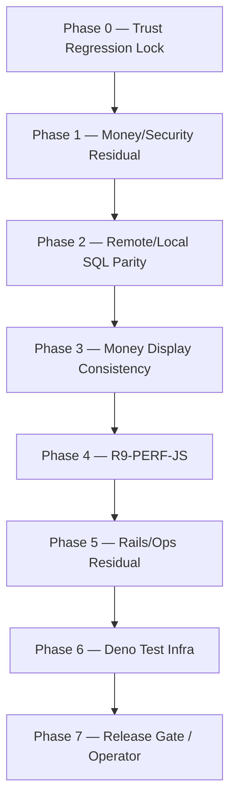

# PLAN — Zero-Defect Critical Hardening (잔여 hardening 정본)

> **버전:** 1.0.0 · **작성일:** 2026-07-14 · **작성 세션:** 문서 작성 전용 (코드/migration/CI 변경 0)
> **상태:** **승인됨 (APPROVED) 2026-07-14** — operator 승인 · **잔여 hardening 정본 확정**. 문서 승인은 Phase 0–7 **일괄 구현 착수를 의미하지 않는다** — 구현 착수는 Phase별 별도 `Implement Phase N` 명령 후에만.
> **재착수 원칙:** 이 문서가 다루는 항목은 **이미 registry상 `VERIFIED_FIXED`인 결함의 재구현이 아니다.** Phase 0/1은 **회귀 잠금(재검증 + 자동화 회귀 테스트)** 만 수행하고, 실제 코드 변경은 Phase 2~6의 **명시된 OPEN/BLOCKED_DEP/PENDING 잔여 항목**에만 국한된다.

## 0. Metadata

| 필드                     | 값                                                                                                                                                                                                                                                                                                       |
| ------------------------ | -------------------------------------------------------------------------------------------------------------------------------------------------------------------------------------------------------------------------------------------------------------------------------------------------------- |
| **문서 버전**            | `1.0.0`                                                                                                                                                                                                                                                                                                  |
| **작성일**               | 2026-07-14                                                                                                                                                                                                                                                                                               |
| **승인 상태**            | **승인됨 (APPROVED) 2026-07-14** · operator 확정 — 잔여 hardening 정본. Phase별 구현은 별도 `Implement Phase N` 명령 필요                                                                                                                                                                                |
| **전체 Risk**            | **High** (Phase 2 SQL conservation · Phase 4 광범위 test churn 포함)                                                                                                                                                                                                                                     |
| **Phase 수**             | **8 (Phase 0–7)**                                                                                                                                                                                                                                                                                        |
| **DoD (문서 전체)**      | (1) Critical(C-01/C-02) + High 잔여 결함 **회귀 잠금** 완료 · (2) OPEN High(`R9-PERF-JS`) **fix 또는 명시적 R11 waiver + Decision Log** · (3) Deno edge-shared 테스트 **CI green** 편입 · (4) Release Gate(§07_RELEASE_READINESS.md) **재판정 가능한 상태**로 정리                                       |
| **근거 감사 원본**       | [`docs/audit/ZERO_ASSUMPTION_FULL_AUDIT_2026-07-13.md`](audit/ZERO_ASSUMPTION_FULL_AUDIT_2026-07-13.md) · [`docs/audit/SYSTEM_AUDIT_2026-07-13/`](audit/SYSTEM_AUDIT_2026-07-13/) (7-Pillar) · [`docs/OPERATIONS/PLATFORM_AUDIT_FINDING_REGISTRY.yaml`](OPERATIONS/PLATFORM_AUDIT_FINDING_REGISTRY.yaml) |
| **정본 vs 본 문서 관계** | 이 문서는 **잔여 hardening 실행 정본**이며 감사 원본을 대체하지 않는다. 최신 상태는 항상 registry + `07_RELEASE_READINESS.md`를 우선 확인한다.                                                                                                                                                           |

## 1. Non-negotiables (전 Phase 공통)

- **Money:** Decimal 전용 · 클라이언트 재계산 0 · 원장 append-only (`30-money-ledger.mdc`, `25-postgres-plpgsql.mdc`).
- **원격 migration apply:** `bun run stack:push-remote`만 — 수동 `supabase db push` / `supabase link` 금지 (`96-prod-apply-agent-deny.mdc`).
- **Heavy gate:** SQL/E2E/`check:full`은 **GitHub CI가 authoritative** — 에이전트 로컬 실행 금지 (G13 · `80-absolute-gate-prohibitions.mdc`).
- **Single Supabase project lock:** `yocjhjsdwoijfdrehzoq`만 (`20-supabase-safety.mdc`).
- **Freeze 준수:** `docs/OPERATIONS/PLATFORM_RELEASE_FREEZE.md` ACTIVE 상태에서는 Critical Fix 외 변경 금지 — Phase 착수 전 Freeze 상태 재확인.
- **중복 생성 금지:** 착수 전 `git status` + Grep/Glob — 신규 parallel 문서/스크립트/RPC 생성 금지, 기존 registry/문서 확장만.
- **테스트 삭제 0:** 기존 vitest/SQL/Deno 테스트 파일 삭제 금지. RED가 나오면 원인 보고 후 지시 대기 (`30-audit-discipline.mdc`).
- **감사 판정:** 근거 파일:라인 없이 PASS/FAIL 단정 금지 — 확인 불가 항목은 `UNVERIFIED` 유지.

## 2. Scope 전체 요약

| 대상                   | In                                                                   | Out                                                  |
| ---------------------- | -------------------------------------------------------------------- | ---------------------------------------------------- |
| **Critical/High 결함** | 회귀 잠금 · 잔여 미해결(SA-01, R9-PERF-JS, H-09) fix/waiver          | registry `VERIFIED_FIXED` 항목의 재구현              |
| **SQL/Migration**      | `ew_e21`/`ew_e22` conservation 원인 확정·수정 · additive migration만 | 광범위 엔진 리라이트 · Freeze 중 non-Critical 기능   |
| **Perf**               | i18n lazy-load 등 Stage1 JS 절감                                     | 차트/Pixi 재설계 · 기능 삭제                         |
| **Test infra**         | Deno `_shared` suite CI 편입 · `test:engine` 오배선 수정             | `_shared` 미커버 모듈 신규 테스트 작성(별도 후속 PR) |
| **Release Gate**       | 체크리스트/템플릿 정리 · 재판정 준비                                 | soak/PPR/3-Owner 서명 대행                           |

## 3. Phase 구조 (실행 순서)

| 감사 원본                                                     | 현재 상태 (정본)                                                                                                                                     | 본 문서 취급                                                 |
| ------------------------------------------------------------- | ---------------------------------------------------------------------------------------------------------------------------------------------------- | ------------------------------------------------------------ |
| C-01 합성 social proof · C-02 `/status` false-green           | [`PLATFORM_AUDIT_FINDING_REGISTRY.yaml`](OPERATIONS/PLATFORM_AUDIT_FINDING_REGISTRY.yaml) **VERIFIED_FIXED** · R1 Evidence                           | Phase 0 = **재검증 + 자동화 회귀 잠금만** (코드 재작성 금지) |
| High 11건 (H-01~H-11)                                         | 대부분 `VERIFIED_FIXED` · H-09 = `BLOCKED_DEP` (Pro+ entitlement)                                                                                    | Phase 1 = 잔여 보안 잠금 + H-09 operator 결제 경로           |
| Medium 21건                                                   | 대부분 `VERIFIED_FIXED`                                                                                                                              | Phase 3/5에서 표시·운영 잔여만                               |
| SA-01 (로컬 migration 2건 원격 미적용 · SQL conservation RED) | `docs/audit/SYSTEM_AUDIT_2026-07-13/02_DATABASE.md` · Release Readiness 38/100 · RC **BLOCKED**                                                      | Phase 2 + Phase 7                                            |
| Deno `_shared` 24/24 · `test:engine` 오배선 · CI 미편입       | 실측 `deno test --no-check supabase/functions/_shared/` **24/24** · [`package.json`](../package.json) `test:engine`에 Deno 파일이 vitest로 잘못 포함 | Phase 6 전용                                                 |
| Release Gate 경로 0→7                                         | [`07_RELEASE_READINESS.md`](audit/SYSTEM_AUDIT_2026-07-13/07_RELEASE_READINESS.md) §5                                                                | Phase 0→7 번호와 1:1 정렬                                    |

---

### Phase 0 — Immediate Launch Trust Protection (Critical)

- **Goal:** C-01(합성 social proof) / C-02(`/status` false-green)가 프로덕션 경로에서 **다시 깨지지 않음**을 증명한다.
- **Why (audit ID):** `C-01`, `C-02` — [`PLATFORM_AUDIT_FINDING_REGISTRY.yaml`](OPERATIONS/PLATFORM_AUDIT_FINDING_REGISTRY.yaml) L10–L60.
- **Severity:** Critical (registry 기준 · 현재 상태 `VERIFIED_FIXED`).
- **Scope In:** landing fail-closed contract 재검증 · `/status` live/unknown 배지 재검증 · Stage1-style vitest/browser smoke를 **회귀 게이트로 고정**.
- **Scope Out:** 새 marketing copy · 새 social proof 기능 · UI 재설계.
- **Task checklist:**
  1. [`R1/r1-trust-truth-implement.md`](OPERATIONS/PLATFORM_AUDIT_CLOSEOUT_EVIDENCE/R1/r1-trust-truth-implement.md) · [`r1-stage1-browser.md`](OPERATIONS/PLATFORM_AUDIT_CLOSEOUT_EVIDENCE/R1/r1-stage1-browser.md) evidence 재확인.
  2. 관련 owner vitest 재실행(로컬 L0~L4) — green 확인.
  3. 회귀 발견 시에만 최소 패치(범위 확장 금지) — RED-first(`30-audit-discipline.mdc`).
  4. registry 상태 `VERIFIED_FIXED` 유지 갱신(변경 없으면 타임스탬프만 갱신하지 않음 — 회귀 시에만 갱신).
- **Files:** `docs/OPERATIONS/PLATFORM_AUDIT_FINDING_REGISTRY.yaml`(C-01/C-02 행), 관련 landing/`/status` owner vitest 경로(재검증 시 확인 후 명시).
- **Safety:** 읽기·테스트 중심 — 코드 변경은 회귀 발견 시에만 최소 패치.
- **Rollback:** 패치 발생 시 해당 커밋만 revert — 회귀 테스트는 유지.
- **Acceptance (binary):**
  - [x] 합성 stats/testimonials/withdrawalProof 노출 0 — 재검증 2026-07-14 (resolver fail-closed · landing-page omit · vitest)
  - [x] `/status`가 unknown 상태에서 success로 표시되는 경로 0 — 재검증 2026-07-14 (failClosed · fetch catch · badge pending)
  - [x] owner vitest green — 2026-07-14 · 4 files · **23/23**
  - [x] registry 상태 `VERIFIED_FIXED` 유지 — 회귀 0 · 타임스탬프 미갱신(계획대로)
- **Phase 0 closeout:** **`[x]` DONE** 2026-07-14 — 회귀 없음 · 코드/커밋 0 · Evidence: R1 implement + Stage1 browser + owner vitest 23/23
- **Required Tests:** 기존 R1 owner vitest suite(경로는 재검증 시 확정) — 신규 duplicate 테스트 생성 금지.
- **Risk:** Low.
- **Dependencies:** 없음 (Phase 0은 독립 착수 가능).
- **Commit Strategy:** 회귀 없으면 커밋 0(검증만). 회귀 패치 시 1 conventional commit — `fix(trust): lock C-01/C-02 regression`.

### Phase 1 — Money / Auth / Wallet Residual Lock (High residual)

- **Goal:** H-02(`rpc_lock_wallet` 범용 노출 revoke) · anon write guard · H-09(HIBP) 경로를 **재확인**한다.
- **Why (audit ID):** `H-02`(registry `VERIFIED_FIXED`), `H-09`(registry `BLOCKED_DEP`, `docs/audit/SYSTEM_AUDIT_2026-07-13/05_SECURITY.md` L22).
- **Severity:** High.
- **Scope In:** privilege probe 문서화(`has_table_privilege`/`has_function_privilege` 재확인) · `stack:auth-hibp-enable` operator runbook 최신화 · grants inventory 회귀 확인.
- **Scope Out:** 신규 money RPC · ledger schema 변경 · 새 GRANT/REVOKE(회귀 없으면 미터치).
- **Task checklist:**
  1. `supabase/tests/grants_rls_inventory_test.sql` 최신 실행 결과가 registry H-02 evidence와 일치하는지 확인(CI `sql` job 로그 참조 — 로컬 heavy gate 금지).
  2. H-09: `bun run stack:auth-hibp-enable` 결과가 여전히 `PRO_PLAN_REQUIRED (402)`인지 재확인, 결과를 `docs/audit/SYSTEM_AUDIT_2026-07-13/07_RELEASE_READINESS.md` §6 Wave 6와 동일하게 문서화.
  3. registry H-02/H-09 항목에 재검증 타임스탬프만 추가(코드 변경 없으면).
- **Files:** `docs/OPERATIONS/PLATFORM_AUDIT_FINDING_REGISTRY.yaml`(H-02/H-09 행), `docs/OPERATIONS/PLATFORM_AUDIT_TODO_HANDOFF.md`(H-09 operator 절 있으면).
- **Safety:** verify-only 기본값 → Low. GRANT/RPC 실제 터치 시에만 Medium.
- **Rollback:** 문서 갱신만이면 rollback 불필요. 코드 터치 시 해당 커밋 revert.
- **Acceptance (binary):**
  - [x] H-02 privilege probe 결과가 registry evidence와 일치 — 2026-07-14 remote MCP: anon_lock=f · auth_lock=f · svc_lock=t · live_crash SELECT/seed=f · `check:wallet-mutators` OK
  - [x] H-09가 여전히 Pro+ 결제만 남은 블로커임을 문서로 재확인 — `stack:auth-hibp-enable` → `PRO_PLAN_REQUIRED` 402 · `BLOCKED_DEP` 유지
  - [x] anon/authenticated에 대한 신규 미검토 write path 0 — remote wallets INSERT/UPDATE=f · inventory pin 유지 · GRANT/REVOKE 코드 변경 0
- **Phase 1 closeout:** **`[x]` DONE** 2026-07-14 — verify-only · **앱/migration/CI 코드 변경 0** · 문서(registry·Release Readiness·Handoff·본 Plan·ACTIVE_WORK)만 재검증 타임스탬프
- **Required Tests:** `supabase/tests/grants_rls_inventory_test.sql`(CI `sql` job 경유) — 로컬 재실행 금지(G13). 대체: remote privilege probe + `check:wallet-mutators`.
- **Risk:** Medium(GRANT/RPC 터치 시) — 기본 verify-only 시 Low.
- **Dependencies:** Phase 0과 독립, Phase 2 이전 완료 권장(같은 SQL 표면 공유).
- **Commit Strategy:** 변경 없으면 커밋 0. 문서 갱신만이면 1 commit — `docs(security): reverify H-02/H-09 residual`.

### Phase 2 — Remote vs Local Divergence (Sacred money path)

- **Goal:** CI `sql` job RED 원인(`ew_e21_hedge_reduce_only_test.sql` / `ew_e22_sports_parity_test.sql` conservation)을 **확정·수정**하여 required 4 job(quality·sql·e2e·advisors) green을 달성하고, green 확인 후에만 `bun run stack:push-remote`를 실행한다.
- **Why (audit ID):** `SA-01` — [`docs/audit/SYSTEM_AUDIT_2026-07-13/FINDINGS.yaml`](audit/SYSTEM_AUDIT_2026-07-13/FINDINGS.yaml) L28–L47 · [`02_DATABASE.md`](audit/SYSTEM_AUDIT_2026-07-13/02_DATABASE.md) · [`07_RELEASE_READINESS.md`](audit/SYSTEM_AUDIT_2026-07-13/07_RELEASE_READINESS.md) §6 Wave 7.
- **Severity:** Medium(등록 severity) / **Impact = Sacred money path** — Release Gate `dod-findings` FAIL의 실질 blocker.
- **Scope In:** `ew_e21`/`ew_e22` conservation 불일치 원인 확정(RAISE NOTICE 계측 또는 동등 방법) · SQL 테스트 수정(테스트 자체가 틀렸으면 테스트, RPC가 틀렸으면 RPC) · migration은 **additive only** · advisor 0 ERROR 확인 · parity check(`check:engine-foundation-parity`) 재실행.
- **Scope Out:** 광범위 엔진 리라이트 · Freeze 중 non-Critical 신규 기능 · 기존 테스트 삭제.
- **Task checklist:**
  1. 로컬 `supabase db reset` → 실패하는 conservation 테스트를 좁혀 재현(가장 싼 계층 — `30-audit-discipline.mdc` RED-first).
  2. 원인이 RPC 로직이면 additive migration 1건으로 수정, 원인이 테스트 기대값이면 테스트만 수정(로직 약화 금지).
  3. 두 파일(`ew_e21`/`ew_e22`)을 **분리된 conservation 축**으로 각각 커밋(`81-efficient-gate-execution.mdc` — 한 PR에 한 conservation 축).
  4. push → `ci:watch` → required 4 job green 확인.
  5. green 확인 **후에만** `bun run stack:push-remote` → remote advisor 0 ERROR.
  6. `check:engine-foundation-parity` 재실행 — local/remote migration count 일치 확인(SA-01 evidence 당시: local 241 · remote 239 · missing 2; **현재 디스크 2026-07-24: 248** · `check:migrations`).
- **Files:** `supabase/tests/ew_e21_hedge_reduce_only_test.sql`, `supabase/tests/ew_e22_sports_parity_test.sql`, 관련 RPC가 있으면 해당 migration(신규 additive), `docs/audit/SYSTEM_AUDIT_2026-07-13/FINDINGS.yaml`(SA-01 상태 갱신).
- **Safety:** local `db reset` + CI가 authoritative · 에이전트 로컬 heavy gate 금지(G13) · `stack:push-remote`만 원격 apply 경로.
- **Rollback:** SQL job이 다시 RED면 해당 migration/테스트 커밋만 revert하고 `stack:push-remote` 보류.
- **Acceptance (binary):**
  - [x] CI `sql` job green — run `29271360173` (2026-07-13) · `supabase db reset + SQL tests` **success**
  - [x] CI required 4 job(quality·sql·e2e·advisors) 전부 green — 동일 run
  - [x] `stack:push-remote` 실행 완료(green 확인 후) — 2026-07-14 재실행 · pending 0 · remote already has all local names
  - [x] remote security advisor 0 ERROR — `stack:push-remote` + MCP `get_advisors` security ERROR **0**
  - [x] `check:engine-foundation-parity` missing 0 — local 244 · remote 244
- **Phase 2 closeout:** **`[x]` DONE** 2026-07-14 — **신규 코드/migration 0** (이미 HEAD에 흡수됨). 원인 = 테스트 하네스(RLS 하 Σ 스냅샷)이지 money RPC 약화가 아님.
  - **E21 축:** `fd9290be` — `ew_e21` conservation Σ 직전에 `RESET ROLE` (authenticated RLS가 타 wallet·system_accounts를 가려 `after≈19998` 거짓 드리프트)
  - **E22 축:** `fd9290be` — partial/full cashout Σ에 `RESET ROLE` (+36 house leg 마스킹 해제) · `8fa65cc9` — E22-3 correct_score를 raw INSERT→`rpc_place_sports_bet`로 교체(stake lock)
  - **Out:** additive money RPC rewrite 0 · 기존 conservation 로직 약화 0 · 테스트 삭제 0
- **Required Tests:** `ew_e21_hedge_reduce_only_test.sql` · `ew_e22_sports_parity_test.sql`(CI `sql` job) — 신규 duplicate SQL 테스트 생성 금지, 기존 파일 수정만.
- **Risk:** **High** (money conservation) — RED-first SQL · 한 PR에 한 conservation 축만.
- **Dependencies:** Phase 0/1 완료 권장(공유 SQL 표면 안정화 후 착수) · Phase 7의 전제 조건.
- **Commit Strategy:** conservation 축마다 1 conventional commit — `fix(sql): resolve ew_e21 conservation` / `fix(sql): resolve ew_e22 conservation` · force push 금지 · `main` 직접 push 금지(feature branch → PR). **본 세션:** 이미 분리된 커밋(`fd9290be` · `8fa65cc9`)이 HEAD/CI에 있으므로 **추가 커밋 0**.

### Phase 3 — Money Display Consistency (PHON / FiatHint / P→PHON)

- **Goal:** "1 PHON=1 KRW"류 거짓 카피 **노출 0** · `FiatHint`는 **표시 전용**(클라이언트 money 재계산 0)을 재확인·잠금한다.
- **Why (audit ID):** Medium 21건 중 화폐 표시 관련 항목 — [`PLATFORM_AUDIT_FINDING_REGISTRY.yaml`](OPERATIONS/PLATFORM_AUDIT_FINDING_REGISTRY.yaml) Medium 섹션 · `ZA-15`(dual-currency) — [`docs/audit/ZERO_ASSUMPTION_FULL_AUDIT_2026-07-13.md`](audit/ZERO_ASSUMPTION_FULL_AUDIT_2026-07-13.md).
- **Severity:** Low–Medium.
- **Scope In:** i18n copy audit(PHON/KRW 환율 오인 카피) · `toFiatHint` / domain FiatHint contract 재확인 · ZA-15 회귀 vitest.
- **Scope Out:** 환율/ledger 계산 로직 변경 · 신규 환율 소스 도입.
- **Task checklist:**
  1. `packages/i18n` 카탈로그에서 "1 PHON=1 KRW" 또는 고정 환율을 암시하는 카피 grep.
  2. `FiatHint` 관련 contract/hook이 서버 RPC 값만 표시하는지(재계산 없는지) 재확인.
  3. ZA-15 관련 owner vitest 재실행 — green 확인.
  4. 발견된 거짓 카피가 있으면 i18n 키 값만 수정(키 삭제/rename 금지 — `90-ui-ux-presentation.mdc`).
- **Files:** `packages/i18n/**`(값만), FiatHint 관련 domain contract(경로는 grep 후 확정).
- **Safety:** copy/UI 변경만 — money engine 미터치.
- **Rollback:** i18n 값 변경 커밋만 revert.
- **Acceptance (binary):**
  - [x] 고정 환율/보장 수익 암시 카피 0 — 재검증 2026-07-14: `1 PHON = 1 KRW` / `1:1로 가치` 활성 노출 0 · `wallet.phon.guide.balance`는 실시간 환율 문구(ZA-15) · landing FiatHint stale→omit(H-01)
  - [x] FiatHint 표시 경로에 클라이언트 재계산 0 — `toFiatHint`는 서버 rate snapshot × 표시용 금액만 · `displayOnly: true` · ledger/payout 재계산 없음 · missing/stale → `—`/omit
  - [x] ZA-15 owner vitest green — 2026-07-14 · 5 files · **36/36** · `check:i18n` green
- **Phase 3 closeout:** **`[x]` DONE** 2026-07-14 — **코드/i18n 값 변경 0** (이미 VERIFIED_FIXED 상태 재확인). 미사용 키 `landing.heroReward.cta.primary`(₩1,000)는 apps 참조 0이라 노출 0 · 키 삭제 금지라 값 미터치.
- **Required Tests:** ZA-15 관련 기존 vitest(중복 생성 금지) · `check:i18n`.
- **Risk:** Low–Medium.
- **Dependencies:** 없음 — Phase 2와 독립적으로 병행 가능.
- **Commit Strategy:** 발견 시 1 commit — `fix(i18n): remove fixed-rate money display copy`. **본 세션:** 회귀/잔여 거짓 카피 0 → **커밋 0**.

### Phase 4 — R9-PERF-JS (OPEN High)

- **Goal:** Web Stage1 initial JS를 **21개 web state 기준 ≤450kB gzip**으로 낮추거나, operator가 R11 explicit waiver + Decision Log를 선택하도록 한다.
- **Why (audit ID):** `R9-PERF-JS` — [`PLATFORM_AUDIT_FINDING_REGISTRY.yaml`](OPERATIONS/PLATFORM_AUDIT_FINDING_REGISTRY.yaml) L1266–L1299 · [`06_PERFORMANCE.md`](audit/SYSTEM_AUDIT_2026-07-13/06_PERFORMANCE.md) §1,§6.
- **Severity:** High — Release Gate `dod-findings` + `runtime-stage1` FAIL 2건의 단일 근본 원인.
- **Scope In:** i18n per-locale async split(dominant lever, 현재 ko+en eager 249.97kB gzip) · 필요한 vitest를 **점진적으로**(소규모 배치) 비동기 렌더 대응으로 마이그레이션.
- **Scope Out:** 차트/Pixi 재설계 · 기능 삭제 · 광범위 무관 리팩토링.
- **Task checklist:**
  1. `I18nProvider`가 로케일을 lazy-load할 수 있는 render-gating 설계(기존 ~140+ 동기 렌더 vitest와의 충돌 범위를 먼저 목록화).
  2. 소규모 PR 단위로 vitest를 async-aware로 전환(한 번에 140+ 배치 금지 — `81-efficient-gate-execution.mdc`).
  3. 매 배치 후 로컬 `bun run typecheck` + 타겟 vitest green 확인 → 다음 배치.
  4. i18n lazy-load 적용 후 Stage1 JS 재계측(측정 전/후 artifact 보관).
  5. ≤450kB×21 미달 시 operator에게 R11 waiver 여부를 질문(§6 Open Questions ①).
- **Files:** `packages/i18n/**`(lazy-load 메커니즘), `apps/web/src/**`(I18nProvider 소비처), 영향받는 vitest 파일들(점진적).
- **Safety:** feature branch 전용 · 측정 전/후 artifact 기록 · 테스트 배치 소분(140+ 일괄 마이그레이션 금지).
- **Rollback:** 배치별로 독립 revert 가능하도록 커밋 분리.
- **Acceptance (binary):**
  - [x] Stage1 initial JS ≤450kB gzip × 21 web states — **local measure 394.00 kB PASS** (2026-07-14 · same modulepreload methodology as Wave 1). Shared entry JS → all web states inherit budget.
  - [x] operator R11 explicit waiver — **불필요** (SLO 달성)
  - [x] i18n lazy-load 전환 후 owner vitest green — Batch1 29/29 · Batch2 27/27 · typecheck · check:i18n
- **Phase 4 closeout:** **`[x]` DONE** 2026-07-14 — ko eager / en dynamic · vitest preload · Evidence [`r9-perf-js-phase4-i18n-lazy.md`](OPERATIONS/PLATFORM_AUDIT_CLOSEOUT_EVIDENCE/R9/r9-perf-js-phase4-i18n-lazy.md) · registry `R9-PERF-JS` → `VERIFIED_FIXED`
- **Required Tests:** `docs/OPERATIONS/PLATFORM_AUDIT_CLOSEOUT_EVIDENCE/R9/r9-stage1-matrix.md` 재측정 · 영향받는 vitest 전체 green(로컬 L0~L4, 전체 vitest는 CI).
- **Risk:** **High**(광범위 test churn) — 소규모 PR 연쇄로 리스크 분산. **완화:** vitest setup preload로 134파일 일괄 마이그레이션 회피.
- **Dependencies:** Phase 2 SQL green 이후 착수 권장(동시 대형 변경 축 분리) · Phase 7의 전제 조건 중 하나.
- **Commit Strategy:** 배치당 1 conventional commit — `perf(i18n): lazy-load locale N of M` · 최종 계측 결과는 별도 `docs(perf): re-measure Stage1 JS after i18n split` 커밋.

### Phase 5 — Rails / Ops Residual

- **Goal:** withdrawal OFF 게이트 및 crypto/giftcard/sports rail fail-closed 상태를 유지하면서, `ZA-12`(트레이드 차트 empty)/`ZA-13`(스포츠 오즈 ingest) 운영 잔여를 문서/런북 수준에서만 정리한다.
- **Why (audit ID):** `H-10`(withdrawal OFF, 운영 의도) · `H-03`/`H-11`/`H-05`(rail fail-closed) · `ZA-12` · `ZA-13` — [`ZERO_ASSUMPTION_FULL_AUDIT_2026-07-13.md`](audit/ZERO_ASSUMPTION_FULL_AUDIT_2026-07-13.md).
- **Severity:** Low.
- **Scope In:** copy/runbook 갱신 · ingest offline banner 회귀 확인.
- **Scope Out:** rail 재노출 · withdrawal flag flip(별도 [`PLATFORM_WITHDRAWAL_REENABLE_GATE.md`](OPERATIONS/PLATFORM_WITHDRAWAL_REENABLE_GATE.md) 5조건 게이트로만 처리 — 본 Phase는 참조만).
- **Task checklist:**
  1. [`TRADE_CHART_SOFT_LAUNCH_CHECKLIST.md`](OPERATIONS/TRADE_CHART_SOFT_LAUNCH_CHECKLIST.md)(ZA-12) 최신 상태 재확인.
  2. [`SPORTS_ODDS_INGEST_RUNBOOK.md`](OPERATIONS/SPORTS_ODDS_INGEST_RUNBOOK.md)(ZA-13) dry-run 전환 조건 재확인.
  3. ingest offline banner가 실제로 렌더되는지 owner vitest로 재검증(신규 테스트 생성 대신 기존 확장).
- **Files:** `docs/OPERATIONS/TRADE_CHART_SOFT_LAUNCH_CHECKLIST.md`, `docs/OPERATIONS/SPORTS_ODDS_INGEST_RUNBOOK.md`.
- **Safety:** 문서/카피 수준 — engine 미터치.
- **Rollback:** 문서 커밋만 revert.
  - **Acceptance (binary):**
  - [x] withdrawal OFF 게이트 문서와 코드 상태 일치 — 2026-07-14 remote MCP: `feature_withdrawal_enabled=false` · [`PLATFORM_WITHDRAWAL_REENABLE_GATE.md`](OPERATIONS/PLATFORM_WITHDRAWAL_REENABLE_GATE.md) Phase 5 재검증 · flag flip **0**
  - [x] rail fail-closed 상태 회귀 0 — `LAUNCH_GATES.cryptoRails/sportsBetting/sportsCashout=false` · wallet-capability-rails + freshness vitest green · dry-run 기본·베팅 게이트 flip **0**
  - [x] ingest offline banner owner vitest green — 2026-07-14 · sports freshness + sports-page + rails + withdrawal-off · **34/34** · trade-chart empty **6/6**
- **Phase 5 closeout:** **`[x]` DONE** 2026-07-14 — **앱/money/SQL/auth/live sports 코드 변경 0** · 문서만(ZA-12 checklist · ZA-13 runbook · withdrawal reenable gate Phase 5 재검증 절) · Soft Launch 운영측(Network 실측·dry-run 해제)은 **OPEN 유지**(의도)
- **Required Tests:** 기존 offline banner/ingest owner vitest(있으면).
- **Risk:** Low.
- **Dependencies:** 없음.
- **Commit Strategy:** 변경 있을 때만 1 commit — `docs(ops): reverify ZA-12/ZA-13 residual`.

### Phase 6 — Test Infrastructure Hardening (Deno edge-shared)

- **Goal:** `deno test --no-check supabase/functions/_shared/`(현재 실측 **24/24**)를 CI에 편입하고, `package.json` `test:engine`의 Deno 파일 오배선을 제거한다.
- **Why (audit ID):** 세션 실측 — Keep **455/455** · Safe-to-delete **0** · `package.json` L51 `test:engine`이 `supabase/functions/_shared/edge-observability.test.ts`(Deno 파일)를 vitest 커맨드에 포함.
- **Severity:** Low(인프라) — 그러나 CI가 Deno suite를 전혀 실행하지 않는 커버리지 공백.
- **Scope In:** `test:engine`에서 Deno 파일 제거 · 신규 `test:deno:edge-shared` 스크립트 추가 · CI `quality` job에 Deno setup + 스크립트 추가(경량 · Docker 불필요) · ACTIVE_WORK/DOCS_INDEX 한 줄 sync.
- **Scope Out:** `_shared` 미커버 모듈(`cors` · `crypto-hd` · `pg-*` · `service-*`)의 신규 테스트 작성 — **별도 후속 PR**로 분리, 본 Phase에 섞지 않음.
- **Task checklist:**
  1. `package.json` `test:engine`에서 `supabase/functions/_shared/edge-observability.test.ts` 제거(vitest 대상에서 제외).
  2. `package.json`에 `"test:deno:edge-shared": "deno test --no-check supabase/functions/_shared/"` 추가.
  3. `.github/workflows/ci.yml` `quality` job에 Deno setup 스텝 + `bun run test:deno:edge-shared` 스텝 추가.
  4. 로컬에서 `bun run test:engine`(vitest만) + `bun run test:deno:edge-shared`(Deno만) 각각 green 확인.
  5. `docs/DOCS_INDEX.md` / `docs/SSOT/ACTIVE_WORK_SSOT.md` 한 줄 sync(본 Implement 세션 §index-ssot-link에서 처리 — Phase 6 자체 구현 세션에서는 코드/CI만).
- **Files:** `package.json`, `.github/workflows/ci.yml`.
- **Safety:** 경량 스크립트/CI 스텝 추가만 — Docker/Supabase stack 불필요, 기존 vitest 대상 축소만(파일 삭제 아님).
- **Rollback:** `package.json` 스크립트 + CI 스텝 revert. **테스트 파일 삭제는 rollback 대상이 아님(원래 삭제하지 않음)**.
- **Acceptance (binary):**
  - [x] `test:engine`이 더 이상 Deno 파일을 포함하지 않음 — 2026-07-14 · vitest paths = money/wallet-ledger/trading/game/sportsbook only · **285/285**
  - [x] `bun run test:deno:edge-shared` 로컬 24/24 green — 2026-07-14 · `deno test --no-check supabase/functions/_shared/`
  - [x] CI `quality` job에 Deno 스텝 존재 — `denoland/setup-deno@v2` + `bun run test:deno:edge-shared` (push 후 CI green은 Phase 7/push-fix)
  - [x] `edge-observability.test.ts` 파일 삭제 0(스크립트 배선만 변경) — 파일 유지 · Deno suite에 포함
- **Phase 6 closeout:** **`[x]` DONE** 2026-07-14 — `package.json` + `.github/workflows/ci.yml`만 · money/SQL/auth/sports **코드 변경 0** · 신규 `_shared` 테스트 작성 **0**
- **Required Tests:** `supabase/functions/_shared/*.test.ts`(Deno, 24/24) · CI `quality` job 재실행.
- **Risk:** Low.
- **Dependencies:** 없음 — 독립 착수 가능. 단, `package.json`/CI 변경이므로 본 Implement 세션(§no-code-this-session)에서는 **실행하지 않고 계획만 문서화**.
- **Commit Strategy:** 1 conventional commit — `test(ci): fix test:engine deno mis-wiring, add deno edge-shared CI job`.

### Phase 7 — Release Gate (operator-heavy)

[`07_RELEASE_READINESS.md`](audit/SYSTEM_AUDIT_2026-07-13/07_RELEASE_READINESS.md) §5 순서를 그대로 따른다:

- **Goal:** Release Gate 17개 criteria를 재판정 가능한 상태로 만들고, Public Launch까지의 operator 실행 경로를 진행한다.
- **Why (audit ID):** `07_RELEASE_READINESS.md` §1(PASS 11 · FAIL 3 · PENDING 3), §5(경로 1→6).
- **Severity:** High(운영) — 그러나 코드 blocker는 Phase 2/4 완료로 해소.
- **Scope In (순서 고정):**
  1. Phase 2 green + `stack:push-remote` 완료(SA-01 정리)
  2. Phase 4 green **또는** DL waiver(R9-PERF-JS)
  3. soak-24h snapshot(operator — [`r10-soak-24h-snapshot.md`](OPERATIONS/PLATFORM_AUDIT_CLOSEOUT_EVIDENCE/R10/r10-soak-24h-snapshot.md) 템플릿)
  4. PPR 24h/72h/7d(operator)
  5. rollback/DR drill(operator, 일정: 2026-08-13 / 2026-10-13)
  6. 3-Owner sign-off → Freeze lift
- **Scope Out:** soak/PPR/drill/서명을 AI가 대행 — 실제 캘린더 시간(최소 7일)과 인간 서명이 필요해 대행 불가(`07_RELEASE_READINESS.md` §6 Wave 7과 동일 근거).
- **Task checklist:**
  1. AI는 각 단계의 **템플릿/체크리스트**만 준비·갱신.
  2. Phase 2/4 완료 여부를 registry 상태로 재확인 후 이 Phase 착수 가능 여부 판단.
  3. operator에게 soak/PPR/drill/서명 일정 확인 요청(문서화만, 대행 금지).
- **Files:** `docs/OPERATIONS/PLATFORM_AUDIT_CLOSEOUT_EVIDENCE/R10/r10-soak-24h-snapshot.md`, `docs/audit/SYSTEM_AUDIT_2026-07-13/07_RELEASE_READINESS.md`(재판정 결과 갱신).
- **Safety:** 템플릿/문서 갱신만 — 서명·캘린더 대행 금지.
- **Rollback:** 문서 커밋만 revert.
- **Acceptance (binary):**
  - [x] Phase 2 green + push-remote 완료 — 재확인 2026-07-14 (Plan Phase 2 `[x]` · parity missing 0 · CI sql green)
  - [x] Phase 4 green 또는 DL waiver 기록 — Phase 4 `[x]` · R9-PERF-JS **VERIFIED_FIXED** · Stage1 **394≤450** · waiver **불필요**
  - [x] soak-24h snapshot 템플릿 준비 완료(실행은 operator) — [`r10-soak-24h-snapshot.md`](OPERATIONS/PLATFORM_AUDIT_CLOSEOUT_EVIDENCE/R10/r10-soak-24h-snapshot.md) **TEMPLATE READY** · Window/서명 **미기입**(AI 대행 0)
  - [x] Release Gate 17 criteria 재판정 결과 문서화 — PASS **13** · FAIL **1**(dr-readiness) · PENDING **3**(operator) · RC **BLOCKED** · [`07_RELEASE_READINESS.md`](audit/SYSTEM_AUDIT_2026-07-13/07_RELEASE_READINESS.md) §1·§7 · [`r11-release-gate-checklist.md`](OPERATIONS/PLATFORM_AUDIT_CLOSEOUT_EVIDENCE/R11/r11-release-gate-checklist.md)
- **Phase 7 closeout:** **`[x]` DONE** 2026-07-14 (AI 트랙) — 문서/템플릿/기계 정본(R11 criteria) 동기화 · **soak/PPR/drill/서명 실행 0** · money/SQL/auth/sports 로직 **0**
- **Required Tests:** `platform-r11-closeout-display-contract` owner vitest · `bun run audit:r11-closeout` (blocked 유지 = 정상).
- **Risk:** High(전체 launch 리스크) — AI 트랙 자체는 Low(문서만).
- **Dependencies:** Phase 2, Phase 4 완료 **필수 선행**.
- **Commit Strategy:** 재판정 결과 갱신 시 1 commit — `docs(release): re-run R11 gate checklist after Phase 2/4`.

## 4. Phase 착수 조건 요약

| Phase | 선행 조건                                              | 독립 착수 가능?          |
| ----- | ------------------------------------------------------ | ------------------------ |
| 0     | 없음                                                   | Yes                      |
| 1     | 없음                                                   | Yes                      |
| 2     | Phase 0/1 완료 권장                                    | 권장(강제 아님)          |
| 3     | 없음                                                   | Yes(Phase 2와 병행 가능) |
| 4     | Phase 2 green 이후 권장                                | 권장(강제 아님)          |
| 5     | 없음                                                   | Yes                      |
| 6     | 없음(단, `package.json`/CI 변경 — 별도 Implement 세션) | Yes                      |
| 7     | **Phase 2 + Phase 4 완료 필수**                        | No                       |

## 5. Global Safety Checklist (전 Phase 공통 · Phase 착수 전/후 확인)

- [ ] `bun run typecheck` green
- [ ] `bun run lint` green
- [ ] `bun run check:i18n` green
- [ ] `bun run check:release` green
- [ ] 영향받는 owner vitest green(L0~L4)
- [ ] CI required 4 job(quality·sql·e2e·advisors) green — push 후 `ci:watch`로 확인, 로컬 heavy gate 금지(G13)
- [ ] Remote security advisor **0 ERROR**(SQL/migration 터치 시)
- [ ] Deno edge-shared **24/24**(Phase 6 이후 CI에 편입된 경우)
- [ ] C-01/C-02 smoke 회귀 0(Phase 0 스코프)
- [ ] `git status`/`git diff` — secrets(.env, key) 커밋 0
- [ ] `docs/SSOT/ACTIVE_WORK_SSOT.md` 갱신(Phase 마감 시 `82-work-doc-closeout-sync.mdc`)

## 6. Open Questions (operator 판정 필요)

1. ~~**R9-PERF-JS 처리 방향**~~ — **해소** 2026-07-14 Phase 4 (i18n lazy · Stage1 **394≤450** · registry `VERIFIED_FIXED` · R11 waiver **불필요**).
2. **H-09 Pro+ 결제 일정** — Supabase Pro+ 결제 완료 시점(코드/스크립트는 준비 완료, `bun run stack:auth-hibp-enable` 1분 내 마감 가능).
3. **Soft Launch soak 개시일** — Phase 2+4 green으로 **코드 전제 충족**. operator가 ISO8601 KST로 개시일을 확정하고 [`r10-soak-24h-snapshot.md`](OPERATIONS/PLATFORM_AUDIT_CLOSEOUT_EVIDENCE/R10/r10-soak-24h-snapshot.md) Window를 채운다 — **AI 대행 금지**.
4. **PPR 달력 재확인** — RC+24h/72h/7d 오프셋은 참고값. Soft Launch 실제 개시일에 맞춰 24h/72h/7d를 다시 잡는다 ([`PLATFORM_POST_RELEASE_REVIEW.md`](OPERATIONS/PLATFORM_POST_RELEASE_REVIEW.md)).
5. **3-Owner 서명 일정** — Security · Runtime · Product 시차 서명(겸임 시 세션 간격 ≥4h). 템플릿: [`r11-3-owner-signoff-template.md`](OPERATIONS/PLATFORM_AUDIT_CLOSEOUT_EVIDENCE/R11/r11-3-owner-signoff-template.md).
6. **DR drill 앞당김 여부** — 기본 일정 2026-10-13 · Public Launch 전이면 앞당김 권장 ([`PLATFORM_DRILL_CALENDAR.md`](OPERATIONS/PLATFORM_DRILL_CALENDAR.md)).

**Operator Action List 정본:** [`07_RELEASE_READINESS.md`](audit/SYSTEM_AUDIT_2026-07-13/07_RELEASE_READINESS.md) §7 (O1–O8).

---

## 승인 후 실행 범위 (참고 — 본 문서 작성 세션 자체는 이 범위를 넘지 않음)

- 본 문서 작성 세션에서는 **오직 이 파일 + DOCS_INDEX/ACTIVE_WORK_SSOT 링크 1줄**만 변경한다.
- 코드/migration/CI 변경은 **0** — 구현 착수는 이 문서 승인 + Phase별 별도 `Implement Phase N` 명령 후에만.
- 각 Phase 섹션의 Task checklist는 **실행 설계**이며, 이 문서 자체의 작성이 해당 Task의 실행을 의미하지 않는다.
