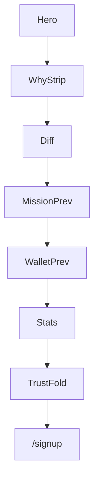

# Landing Product Spec — CVR-First IA

> **상태:** Phase 0 skeleton · **동결:** 2026-07-05  
> **상위:** [`PRODUCT_OPERATING_SYSTEM.md`](PRODUCT_OPERATING_SYSTEM.md)  
> **구현 ADR:** [`ADR/003-landing-timeless-conversion.md`](ADR/003-landing-timeless-conversion.md)  
> **현행 코드:** `landing-page.tsx` · `landing-display-contract.ts` (§28 baseline)

---

## 1. 목표

랜딩 `/`는 **사람을 가입시키는 페이지**다.  
문서·디자인 완성도와 별도로, CVR 모듈 구현이 가치의 중심.

**3초 테스트:** 방문자가 “왜 여기?” · “무엇을 하면?” · “얼마를 받을 수?”를 fold 안에서 답할 수 있어야 한다.

---

## 2. Revised IA (CVR-first fold)

```text
[Header]
Hero (brandLine B + benefit headline + CTA)
  ↓
Why PHONARA strip (4-step + no-investment)          ← 신규
  ↓
Differentiators (5 benefit bullets)                   ← 신규
  ↓
Mission Preview (featured card — quiz 3min +200P)   ← 신규 fold
  ↓
Wallet Preview (2,900 PHON ≈ ₩2,900)                ← 신규
  ↓
Cumulative stats (L0a) · celebration
  ↓
Withdrawal momentum (L0b hidden@presentation)
  ↓
Activity feed · missions grid · withdrawal proof
  ↓
Testimonials (L5 if verified)
  ↓
Trust metrics
  ↓
FAQ (8 core 💰→🚀 + 3 bonus · 불안 제거 순)
  ↓
Final CTA (첫 보상… · 무료로 시작하기)
[Footer — official social only · no fake partners]
```



**기존 §28 섹션** (pillars · missions grid · trust · FAQ · final CTA)은 유지.  
신규 모듈은 **hero fold 위쪽·stats 위**에 삽입.

---

## 3. CVR 갭 7항 → 컴포넌트 매핑

### 3.1 Why PHONARA? (Hero 직하 · 1위)

**문제:** `시간이 수입이 됩니다.` 만으로 3초 내 “왜 여기?” 불명.

**카피 (i18n):**

```text
가입 → 미션 → 적립 → 출금
복잡한 투자 없이 시작할 수 있습니다.
```

| 산출              | 파일                                                                      |
| ----------------- | ------------------------------------------------------------------------- |
| `LandingWhyStrip` | hero subline + 4-step micro-flow (Lucide icons)                           |
| i18n              | `landing.why.subline` · `landing.why.flow.*` · `landing.why.noInvestment` |

**IA:** Hero **바로 아래** (stats보다 위).

---

### 3.2 경쟁 차별성 (2위)

**문제:** 리워드앱 대비 무엇이 다른지 없음.

**UI:** 경쟁사 이름 **랜딩 노출 금지**. benefit checklist:

```text
✓ 출석  ✓ 퀴즈  ✓ 추천  ✓ 다양한 미션  ✓ 언제든 출금
```

| 산출                     | 파일                                                          |
| ------------------------ | ------------------------------------------------------------- |
| `LandingDifferentiators` | 5 bullet · Lucide check · 1 row mobile scroll / 2-row tablet+ |
| i18n                     | `landing.diff.*`                                              |

**위치:** Why Strip 직하.

---

### 3.3 Mission Preview (3위)

**문제:** Mission Card 약함 · “아 이런 걸 하는구나” 즉시 이해 부족.

**스펙 (hero fold · 최소 1장 prominent):**

```text
오늘의 퀴즈 · 3분 · +200 PHON · ★★★★★ (catalog difficulty/presentation)
```

| 필드           | 소스                                                    |
| -------------- | ------------------------------------------------------- |
| title · reward | `LANDING_MISSION_TEASERS` / earn catalog                |
| duration       | `landing.missions.duration.*` (presentation)            |
| stars          | presentation difficulty only — **not** fake user rating |

| 산출                        | 파일                                            |
| --------------------------- | ----------------------------------------------- |
| `LandingMissionPreviewCard` | time-first · reward tabular-nums · CTA → signup |
| `LandingMissionPreviewRow`  | hero-adjacent 1 featured + 2 compact            |

기존 `landing-missions` 섹션 유지 · **fold 우선** preview가 신규.

---

### 3.4 Wallet Preview (4위)

**문제:** Earn→Wallet→Play 중 Wallet이 랜딩에 안 보임.

**스펙 (presentation · engine 0):**

```text
내 PHON    2,900    ≈ ₩2,900    [출금]
```

| 규칙                              |                                               |
| --------------------------------- | --------------------------------------------- |
| 1 PHON = 1 KRW display + footnote | fiat line                                     |
| 금액                              | presentation constant — **not** user balance  |
| CTA                               | signup deep-link · “출금”은 가입 후 가능 copy |

| 산출                   | 파일                                              |
| ---------------------- | ------------------------------------------------- |
| `LandingWalletPreview` | card · tabular-nums · withdraw ghost CTA          |
| contract               | `LANDING_WALLET_PREVIEW_PHON` in display-contract |

**위치:** Mission Preview 직후.

---

### 3.5 Social Proof — Testimonials (5위)

**문제:** 823,000명 숫자만 · 사람 신뢰 부족.

| 규칙                  |                                    |
| --------------------- | ---------------------------------- |
| 3~5 testimonial cards | 별점 · 인용 · 마스킹 이름 (`김**`) |
| Proof tier L5         | operator-verified **실제** 후기만  |
| 금지                  | 허위·조작·미승인 · 수익 약속       |
| cold-start            | 후기 0건 → **섹션 숨김**           |

| 산출                        | 파일                                                     |
| --------------------------- | -------------------------------------------------------- |
| `LandingTestimonials`       | resolver-gated                                           |
| `landing-proof-resolver.ts` | `testimonials: 'hidden' \| 'presentation' \| 'verified'` |
| contract pool               | `LANDING_TESTIMONIAL_POOL`                               |

숫자 proof (L0a)와 testimonial (L5) **병행**.

---

### 3.6 Brand Shape (6위)

BrandLine만으로 recall 부족 → **Phase 4** (geometric symbol).  
Phase 1–2: flat `BrandMark` + timeless tokens ([`DESIGN_CHARTER.md`](DESIGN_CHARTER.md)).

---

### 3.7 Analytics (7위)

이벤트 목록: [`SUCCESS_METRICS.md`](SUCCESS_METRICS.md) §2.  
Contract: `landing-analytics-display-contract.ts` (Phase 1).

---

## 4. Proof tiers

| Tier | ID                  | Mode              | Notes                                |
| ---- | ------------------- | ----------------- | ------------------------------------ |
| L0a  | cumulative stats    | presentation/live | `LANDING_CUMULATIVE_STATS_THRESHOLD` |
| L0b  | withdrawal momentum | live only         | hidden @ presentation · Phase 4      |
| L1   | activity ticker     | ambient/live      | 기존 `LiveActivityTicker`            |
| L5   | testimonials        | resolver-gated    | operator-approved pool               |

---

## 5. Resolver contract (sketch)

```typescript
// landing-proof-resolver.ts (Phase 1)
type LandingProofResolver = {
  testimonials: 'hidden' | 'presentation' | 'verified';
  stats: 'hidden' | 'presentation' | 'live';
  walletPreview: 'presentation'; // constant until Phase 4
};
```

---

## 6. i18n key index (신규 · add-only)

| Prefix                        | Module                |
| ----------------------------- | --------------------- |
| `landing.why.*`               | Why strip             |
| `landing.diff.*`              | Differentiators       |
| `landing.missions.duration.*` | Mission preview       |
| `landing.wallet.*`            | Wallet preview        |
| `landing.testimonial.*`       | L5 pool               |
| `landing.faq.{id}.q` / `.a`   | FAQ 8+3 (이모지 in q) |
| `landing.faq.title`           | FAQ section title     |
| `landing.finalCta.*`          | Final CTA block       |

기존 `landing.*` · `platform.positioning.*` 키 **삭제·rename 금지**.

---

## 7. FAQ — 가입 직전 불안 제거

**역할:** 단순 Q&A가 아님 — 사용자 머릿속 질문을 **제목 그대로** 사용.  
**심리 흐름:** 신뢰 → 시간 → 출금 → 방법 → 비용 → 안전 → 자격 → 행동.

### Contract 변경 (Phase 1)

**기존** `LANDING_FAQ_IDS`: `withdraw` · `free` · `why` · `safe` (4개) → **폐기·교체**.

**신규 정본 순서** (`LANDING_FAQ_IDS` · 이모지는 i18n 질문 문자열에 포함):

| #   | id             | 심리 | 질문 (ko · 이모지 포함)        |
| --- | -------------- | ---- | ------------------------------ |
| 1   | `canGetPaid`   | 신뢰 | 💰 정말 돈을 받을 수 있나요?   |
| 2   | `timeNeeded`   | 시간 | ⏱ 얼마나 시간이 걸리나요?      |
| 3   | `withdrawWhen` | 출금 | 📤 출금은 언제 가능한가요?     |
| 4   | `howEarn`      | 방법 | 🎯 어떻게 적립하나요?          |
| 5   | `signupFee`    | 비용 | 💳 가입비가 있나요?            |
| 6   | `privacy`      | 안전 | 🔒 개인정보는 안전한가요?      |
| 7   | `whoCanUse`    | 자격 | 🌎 누구나 이용할 수 있나요?    |
| 8   | `startNow`     | 행동 | 🚀 지금 바로 시작할 수 있나요? |

**보너스 3항** (`LANDING_FAQ_BONUS_IDS` · core 8 아래 · 동일 accordion):

| id                 | 질문 (ko · 이모지)                    |
| ------------------ | ------------------------------------- |
| `whereWallet`      | 💼 적립한 보상은 어디에서 확인하나요? |
| `missionsOptional` | ✅ 미션을 꼭 모두 해야 하나요?        |
| `afterWithdraw`    | 📋 출금 신청 후에는 어떻게 되나요?    |

i18n: `landing.faq.{id}.q` · `landing.faq.{id}.a` · **ko+en** (en은 동일 톤·이모지 유지).

### 답변 카피 정본 (ko)

1. **canGetPaid** — 네. 미션을 완료하고 조건을 충족하면 보상이 적립되며, 출금 가능한 금액에 도달하면 출금을 신청할 수 있습니다. 모든 보상은 운영 정책과 검토 절차를 거쳐 지급됩니다.
2. **timeNeeded** — 사람마다 다르지만 많은 미션은 몇 분 안에 완료할 수 있도록 설계되어 있습니다. 가능한 시간만큼 자유롭게 참여할 수 있습니다.
3. **withdrawWhen** — 출금 조건을 충족하면 언제든 출금을 신청할 수 있습니다. 처리 시간은 검토 절차와 결제 수단에 따라 달라질 수 있습니다.
4. **howEarn** — 출석, 퀴즈, 추천 등 다양한 미션에 참여하면 보상이 적립됩니다. 각 미션마다 지급 조건과 보상 금액이 명확하게 안내됩니다.
5. **signupFee** — 없습니다. 회원가입은 무료이며, 원하는 미션만 선택해서 참여할 수 있습니다.
6. **privacy** — 개인정보는 관련 법령과 개인정보 처리방침에 따라 보호됩니다. 필요한 경우에만 정보를 수집하며, 서비스 운영 목적 외에는 사용하지 않습니다.
7. **whoCanUse** — 서비스 이용 가능 국가와 연령 기준을 충족하면 누구나 가입할 수 있습니다. 일부 기능은 본인 확인이 필요할 수 있습니다.
8. **startNow** — 네. 회원가입 후 바로 이용 가능한 미션부터 시작할 수 있습니다.

**보너스:** whereWallet — 적립된 보상은 내 지갑에서 언제든 확인할 수 있습니다. · missionsOptional — 아닙니다. 원하는 미션만 자유롭게 선택해서 참여할 수 있습니다. · afterWithdraw — 신청한 출금은 순차적으로 검토되며, 처리 상태를 내 지갑에서 확인할 수 있습니다.

### Voice Charter (FAQ)

- **허용:** 조건부·정책 기반 표현 (“조건 충족 시”, “검토 절차”, “달라질 수 있습니다”)
- **금지:** guaranteed-profit · “오늘 10만원” · 허위 출금 약속 · 가입 유도 과장

### UI · 컴포넌트

| 산출                | 스펙                                                                              |
| ------------------- | --------------------------------------------------------------------------------- |
| `LandingFaqSection` | accordion · **위 순서 고정** · 질문에 이모지 **그대로 렌더** (별도 아이콘 불필요) |
| `LandingFinalCta`   | FAQ 직후 · signup 직전 마지막 밀어내기                                            |
| section title       | `landing.faq.title` — 예: `가입 전 궁금한 점`                                     |

### Final CTA (FAQ 직후 · `LandingFinalCta`)

```text
첫 보상은 생각보다 가까울 수 있습니다.
가입은 무료입니다.
오늘 바로 첫 미션을 시작해 보세요.
[무료로 시작하기]
```

| i18n key                  | ko                                     |
| ------------------------- | -------------------------------------- |
| `landing.finalCta.line1`  | 첫 보상은 생각보다 가까울 수 있습니다. |
| `landing.finalCta.line2`  | 가입은 무료입니다.                     |
| `landing.finalCta.line3`  | 오늘 바로 첫 미션을 시작해 보세요.     |
| `landing.finalCta.button` | 무료로 시작하기                        |

Primary CTA → `buildLandingSignupHref` · `data-analytics-event="landing.finalCta.click"` (hero CTA와 동급).

### 테스트 (Phase 1)

- `landing-display-contract` — 8+3 id 순서 단언
- `landing-page.test` — 첫 FAQ = `💰 정말 돈을 받을 수 있나요?` · accordion expand · final CTA href
- 기존 `withdraw` / `free` / `why` / `safe` 키 참조 **0**

---

## 8. Gates & signoff

```text
gate:ai-impl --test apps/web/src/product/surfaces/landing
gate:ai-impl --test apps/web/src/domain (landing-*)
390 / 768 / 1024 · axe critical 0 · dead control 0
L0a/L5 copy → operator + legal (광고 사용 시)
```

---

## 9. FAIL

- fold 아래에만 CVR 모듈 배치 (stats 위 우선순위 위반)
- fake user star rating on missions
- wallet preview가 live balance처럼 보이는 copy
- testimonial placeholder when pool empty
- competitor names on landing
