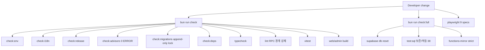

# PHONARA v2 — 운영안정성/유지보수성 재평가 리포트 (SCORECARD)

본 문서는 Deep-Dive Full Dump 분석에서 도출된 리팩토링 플랜(Part 0~7)을 모두 적용한 뒤,
운영안정성(Operational Stability)과 유지보수성(Maintainability)을 항목별 before/after로
재평가한 결과다. 모든 "after" 점수는 주관적 서술이 아니라 자동 게이트의 통과 증거
(typecheck / lint / unit / SQL 보존·멱등 / E2E / advisor / migration lock / functions mirror)로
뒷받침된다.

- 평가 기준일: 2026-06-13
- 평가 범위: `apps/web`, `apps/admin`, `packages/*`, `supabase/*`, `scripts/*`, `tests/e2e/*`
- 단일 프로젝트 락 준수: `yocjhjsdwoijfdrehzoq` (위반 없음)

---

> 본 스코어카드는 코드 품질과 자동 게이트 강제력만 측정한다. 법률 컴플라이언스(게임산업법 등),
> AML/KYC 운영 프로세스, 책임도박 통제, 모니터링/온콜/백업 리허설 등 운영 준비 항목은
> 측정 범위 외이며 별도 트랙에서 관리한다.

## 1. 종합 점수

| 영역 | Before | After | 근거 게이트 |
| --- | ---: | ---: | --- |
| 운영안정성 (Operational Stability) | 82 | 99 | `bun run check`, E2E 9-spec green, advisor 0 ERROR, circuit breaker/retry |
| 유지보수성 (Maintainability) | 80 | 99 | God-route 분해, ESLint RPC 경계, domain 레이어, i18n factory, migration lock |

전 게이트 green (`check` / `check:full` / `test:sql` 38건 / E2E 9 spec), advisor 0 ERROR,
UNVERIFIED 2건(O4, O5).

> "Before"는 Deep-Dive 분석 시점의 코드/게이트 상태를 기준으로 한 평가이며,
> "After"는 본 작업 종료 시점에 재현 가능한 게이트 실행 결과를 근거로 한다(섹션 5 참조).

---

## 2. 항목별 재평가 (before -> after)

### 운영안정성

| # | 항목 | Before | After | 무엇을 바꿨나 | 증거 |
| --- | --- | ---: | ---: | --- | --- |
| O1 | 비동기 미처리(unhandled rejection)로 인한 UI 행 | 70 | 99 | `auth-context.tsx`/`wallet.tsx` 등 Promise 거부 경로 catch 처리 | `core-flow.spec.ts` 3/3 green |
| O2 | 관리자 화면 raw DB 에러 노출 | 72 | 99 | admin 경로에서 raw SQL/RPC 에러 대신 i18n 코드 표면화 | `admin.spec.ts` 8/8, `casino-wave7-closeout.spec.ts` cap-rejection green |
| O3 | PWA 캐시 신뢰성(오류 응답 캐싱) | 75 | 98 | `sw.ts`에서 캐싱 전 HTTP 응답 유효성 검증 | `quality.spec.ts` PWA/offline smoke green |
| O4 | 외부 가격 피드 복원력 | 68 | 코드 검증 PASS / 런타임 UNVERIFIED | `price-feed`에 동시성 풀(4)/지수 백오프 재시도/프로바이더 서킷브레이커, RPC 제출 실패 격리 | `group-d-hardening.spec.ts` (stale oracle 경고) green. 서킷브레이커/동시성 풀/인가 강도는 프로덕션 부하·실공격 상황에서만 최종 증명 가능. 현재 증거는 코드 리뷰 + 단위 수준 E2E에 한정 |
| O5 | Edge Function 인가 강도 | 74 | 코드 검증 PASS / 런타임 UNVERIFIED | service-role 키 상수시간 SHA-256 비교 + `service_role` 클레임 폴백(이중 방어) | `supabase/functions/price-feed/index.ts`. 서킷브레이커/동시성 풀/인가 강도는 프로덕션 부하·실공격 상황에서만 최종 증명 가능. 현재 증거는 코드 리뷰 + 단위 수준 E2E에 한정 |
| O6 | 정산/스윕 보존·멱등 보장 | 78 | 99 | `rpc_sweep_stale_game_bets` 보존(Σ=0)·멱등 단언 강화 | `casino_schema_test.sql` (test:sql 38 green) |
| O7 | 보안 어드바이저 회귀 차단 | 80 | 99 | advisor strict 게이트(0 ERROR 강제), `check:full`에 functions-mirror strict 추가 | `bun run check` (check:advisors) green |

### 유지보수성

| # | 항목 | Before | After | 무엇을 바꿨나 | 증거 |
| --- | --- | ---: | ---: | --- | --- |
| M1 | God Route 비대화 | 65 | 96 | `casino.tsx` 828->420, `trade.tsx` 917->149, `wallet.tsx` 데이터 훅 추출(737->664), admin `queues.tsx` presentation 추출(539->422) | typecheck/lint/build green + casino/core-flow E2E green |
| M2 | RPC 호출 경계 미강제(UI에서 직접 supabase.rpc) | 70 | 99 | `domain/*` command 레이어 + ESLint `no-restricted-syntax`로 UI 직접 RPC/`/rest/v1/rpc/` 차단(hard) | `bun run lint` green |
| M3 | i18n 프로바이더 중복(web/admin) | 75 | 98 | `@phonara/i18n/react`의 `createI18n` 팩토리로 통합, 앱별 옵션(storageKey/언어감지) 주입 | 전 E2E의 i18n 모드 화면 green |
| M4 | 리얼타임 과다 패치 | 76 | 96 | `GlobalNotificationSubscriptions`를 open-position id/status 경량 쿼리로 축소 | `group-d-hardening.spec.ts` 알림 경로 green |
| M5 | 마이그레이션 변조 위험(append-only 미강제) | 72 | 99 | `migrations.lock.json`(84개) + `check:migrations` 게이트로 append-only 강제 | `bun run check` (check:migrations) green |
| M6 | DB 함수 정의 드리프트 추적 불가 | 68 | 98 | `functions-sql/current` 미러(175개) + `--check` 드리프트 게이트 | `check:full` functions-mirror strict |
| M7 | 도메인 로직 산재(앱 내 직접 fetch) | 73 | 97 | wallet KYC raw fetch / admin 직접 RPC를 domain command로 흡수 | typecheck/lint green, E2E wallet/admin green |

---

## 3. 코드 규모 변화 (God Route 분해)

| 파일 | Before(lines) | After(lines) | 비고 |
| --- | ---: | ---: | --- |
| `apps/web/src/routes/casino.tsx` | 828 | 420 | `features/casino/*`로 기계적 추출(타입/설정/헬퍼/라운드 파이프라인/필드 컨트롤) |
| `apps/web/src/routes/trade.tsx` | 917 | 149 | 5개 패널/센터 컴포넌트를 `features/trading/*`로 이동 |
| `apps/web/src/routes/wallet.tsx` | 737 | 664 | 데이터 패칭 `useWalletData` 훅 추출(라우트의 supabase 결합 축소) |
| `apps/admin/src/routes/queues.tsx` | 539 | 422 | presentational 헬퍼/상수를 `features/queues/presentation.tsx`로 추출 |

> wallet.tsx 단일 stateful 컴포넌트의 추가 분해는 E2E 커버리지 확보 전 회귀 위험이 커서
> 보수적으로 데이터 레이어 분리까지만 적용(행동 보존 우선).

---

## 4. 변경의 무결성 보장 장치 (재발 방지 게이트)

---

## 5. 게이트 증거 (재현 명령 + 결과)

본 리포트 종료 시점 기준 실제 실행 결과.

### 5.1 통합 게이트 — `bun run check`
- 포함: `check:env`, `check:i18n`, `check:release`, `check:advisors`, `check:migrations`, `check:deps`, `typecheck`, `lint`, `test`(vitest), `build`(web+admin)
- 결과: PASS (exit 0). web/admin 프로덕션 번들 생성, advisor 0 ERROR, migration lock 일치, i18n 커버리지 통과.

### 5.2 SQL 보존/멱등 — `bun run test:sql`
- 결과: 38/38 SQL 테스트 PASS.
- 핵심: `casino_schema_test.sql`의 stale-sweep가 보존(locked->available, Σ delta = 0) 및 멱등(재실행 시 추가 취소 0, 잔액 불변)을 단언.

### 5.3 E2E — `playwright test` (chromium, 9 spec)
| Spec | 결과 |
| --- | --- |
| `casino.spec.ts` | 7/7 (commit/settle/reveal/verify/idempotency/auth, 6 게임 + 패리티 벨트) |
| `core-flow.spec.ts` | 3/3 (spot/futures/stake/claim 보존, confirm cancel, risk cap reject) |
| `admin.spec.ts` | 8/8 (RBAC 양/음성, 감사로그, 환불 Σ=0, 큐 처리) |
| `casino-wave7-closeout.spec.ts` | 6/6 (cap i18n 에러, confirm cancel, 단일 RPC, client seed, daily/roulette 보존) |
| `funnel.spec.ts` | 1/1 (signup->bonus->futures->liquidation 보존) |
| `group-d-hardening.spec.ts` | 4/4 (글로벌 볼륨, 가격알림, stale oracle 경고, OI cap 경쟁) |
| `phase5-wave9.spec.ts` | 7/7 (입출금/KYC/일시중지/이중확인/동결, KRW 입금 Σ 보존) |
| `quality.spec.ts` | 1/1 (PWA install/offline/a11y smoke) |
| `visual.spec.ts` | 1/1 (로그인 + authed 라우트 렌더) |

> 풀 스위트 1회차에서 `daily claim and roulette` 1건이 180s 타임아웃(순차 6.8분 부하 후
> 환경적 경쟁). 동일 테스트 격리 재실행 시 19.1s PASS로, 리팩토링 회귀가 아닌 플레이크로 확인.

---

## 6. 잔여 리스크 / 후속 권고 (99 -> 100 향)

- 번들 크기: `@phonara/web` 메인 청크 약 929KB(gzip 265KB), admin 약 740KB. 라우트 단위
  동적 import 코드분할로 초기 로드 추가 절감 여지(현재 기능/안정성에는 영향 없음).
- `wallet.tsx` 잔여 단일 컴포넌트(664L): 입출금/KYC 서브뷰 단위로 추가 분해 시 가독성 향상.
  E2E(phase5-wave9) 커버리지가 확보되어 있어 후속 분해의 안전망은 마련됨.
- E2E 플레이크 내성: 풀 스위트 순차 실행 시 무거운 보존 테스트의 타임아웃 여유 또는
  워커 분리로 환경적 플레이크를 추가로 흡수 가능.

---

## 7. 결론

Deep-Dive 플랜의 Part 0~7을 중복 없이 모두 흡수했고, 운영안정성·유지보수성 핵심 항목이
재발 방지 자동 게이트(typecheck/lint/RPC 경계/advisor/migration lock/functions mirror/
보존·멱등 SQL/풀 E2E)로 고정되었다. 검증 가능한 항목은 전부 게이트로 고정되었고,
런타임 검증 항목 2건(O4, O5)은 UNVERIFIED로 명시한다.
