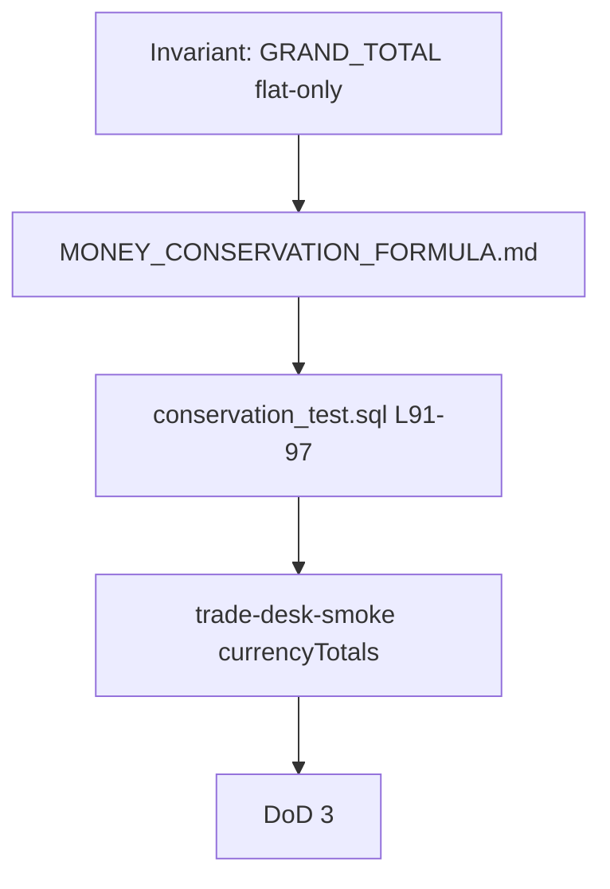
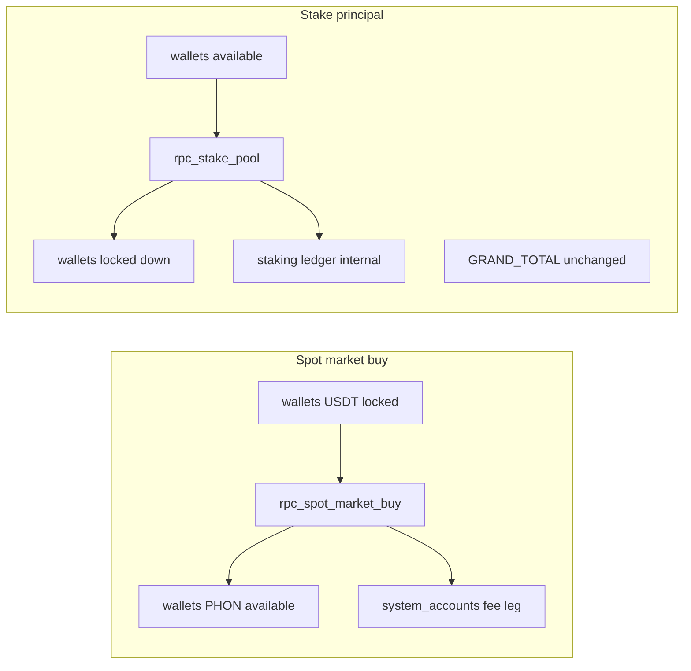

# Money Conservation Formula — Wallet Σ SSOT

> **Tier:** P0-0 · **상태:** `[x]` Agent Implemented 2026-07-07  
> **역할:** Trade Desk Zero-Defect DoD #0 · #3의 **유일한 Σ 정본** — P0-0 완료 전 DoD에 Σ=0 인용 **금지**  
> **증거:** [`TRADE_DESK_ZERO_DEFECT_EVIDENCE/P0-0/`](../OPERATIONS/TRADE_DESK_ZERO_DEFECT_EVIDENCE/P0-0/)

---

## 1. Wallet Conservation (현재 Σ)

### 1.1 용어

| 용어                             | 의미                                                                               |
| -------------------------------- | ---------------------------------------------------------------------------------- |
| **Wallet Conservation (현재 Σ)** | `wallets` + `system_accounts` grand total 불변 — P0~P4 DoD #3 정본                 |
| **Accounting Invariant (확장)**  | `wallet_ledger` journal·settlement·reserve·fee·treasury — §2 roadmap (Engine Wave) |

### 1.2 GRAND_TOTAL 정의

통화 `c ∈ {PHON, USDT}`:

```text
GRAND_TOTAL(c) =
  Σ wallets (available_c + locked_c)     -- 전체 사용자 지갑
+ Σ system_accounts.balance              -- WHERE currency = c

불변 조건: deposit/withdraw/mint(의도적) 제외한 모든 trade/settlement RPC 후
  GRAND_TOTAL(c)_after = GRAND_TOTAL(c)_before   (통화별 독립)
```

**PHON 열 매핑:** `phon_available + phon_locked`  
**USDT 열 매핑:** `usdt_available + usdt_locked`

### 1.3 Σ에 포함되지 않는 것

| 항목                               | 이유                                                                        |
| ---------------------------------- | --------------------------------------------------------------------------- |
| futures position notional          | 마진은 `wallets.locked`에 이미 반영 · PnL은 settlement 시 ledger 이동       |
| **unrealized PnL (open position)** | mark price 변동 중 equity는 변하나 **GRAND_TOTAL은 flat 시점에서만 assert** |
| open order 예약금                  | `wallets.locked`에 포함                                                     |
| staking principal                  | stake RPC가 wallet→staking ledger로 이동 · **grand total 불변**             |
| funding 미정산 accrual             | 정산 전 internal ledger · settlement RPC 시 grand total 불변                |

### 1.4 Σ assert 유효 시점 (non-waivable)

| 상태                                           | Σ=0 assert                                                  |
| ---------------------------------------------- | ----------------------------------------------------------- |
| Spot/futures **flat** (position 0 · 정산 완료) | ✅ 유효                                                     |
| Futures **open** (mark price 변동 중)          | ❌ 범위 외 — 의도적 제외                                    |
| Deposit pending / withdraw locked              | ❌ 범위 외 — deposit/withdraw는 grand total **의도적 변경** |

### 1.5 Epsilon (허용 오차)

| 계층       | 규칙                                 | 근거                                                                                                                                                     |
| ---------- | ------------------------------------ | -------------------------------------------------------------------------------------------------------------------------------------------------------- |
| Engine/SQL | **0** (NUMERIC exact)                | [`conservation_test.sql`](../../supabase/tests/conservation_test.sql) L64–69, L91–97                                                                     |
| E2E        | **0 at 6dp** — 문자열 exact equality | [`wallet-money.ts`](../../tests/e2e/fixtures/wallet-money.ts) L308–332 · [`trade-desk-smoke.spec.ts`](../../tests/e2e/trade-desk-smoke.spec.ts) L128–150 |
| UI         | float 연산 **금지**                  | `@phonara/money` Decimal only                                                                                                                            |

### 1.6 검증 시점

| 테스트                 | 시점                                                                 | 파일:라인                           |
| ---------------------- | -------------------------------------------------------------------- | ----------------------------------- |
| E2E spot buy           | RPC **직전** `before` → RPC **성공 직후** `after`                    | `trade-desk-smoke.spec.ts` L128–150 |
| E2E futures open+close | open 전 → **close 완료 후** (position 0)                             | `trade-desk-smoke.spec.ts` L190–229 |
| E2E stake+claim        | stake 전 → **claim 완료 후**                                         | `trade-desk-smoke.spec.ts` L280–326 |
| SQL integration        | RPC 시퀀스 **전** snapshot → **전체 시퀀스 후** (futures close 포함) | `conservation_test.sql` L63–97      |

### 1.7 Invariant → Formula → SQL → E2E → DoD



### 1.8 Fee / staking 흐름 (Money DoD 기준점)



> fee leg는 `system_accounts`에 흡수 — GRAND_TOTAL 불변 유지 · staking은 wallet→internal 이동만

---

## 2. Accounting Invariant Roadmap (Engine Wave · 출시 차단 아님)

> **Wallet Conservation(GRAND_TOTAL)을 만족한다고 Accounting Invariant(journal leg·pending deposit·settlement reserve·fee treasury 분해)가 자동으로 만족되는 것은 아니다.**  
> P0~P4 DoD #3은 **Wallet Conservation만** 검증한다.

| 계정/개념                                               | 현재 GRAND_TOTAL 포함  | 확장 문서화 대상                |
| ------------------------------------------------------- | ---------------------- | ------------------------------- |
| `wallets` available+locked                              | ✅ 포함                | —                               |
| `system_accounts` (house/insurance/liquidity/dust/mint) | ✅ 포함                | treasury·reserve 분해           |
| `wallet_ledger` append-only journal                     | hash-chain 검증만      | journal leg Σ=0 per transaction |
| Deposit pending → wallet                                | ❌ 의도적 변경         | pending 상태 machine            |
| Withdraw lock → settlement                              | ❌ 의도적 변경         | settlement reserve              |
| Fee legs                                                | system_accounts에 흡수 | fee account 명시 분리           |

Engine Wave 착수 시 [`ENGINE_BOUNDARY.md`](ENGINE_BOUNDARY.md) §Engine Wave defer · [ADR-007](../PRODUCT/ADR/007-engine-wave-accounting-invariant-defer.md) Accepted + P4-D operator 승인.

---

## 3. Code citations (L1 gate · `check:money-formula-citations`)

> 스크립트가 아래 manifest를 파싱 — path 존재 · line 범위 · GRAND_TOTAL 키워드 대조.

<!-- money-formula-citations:v1
citation: supabase/tests/conservation_test.sql:64-69:phon_available,phon_locked,system_accounts
citation: supabase/tests/conservation_test.sql:91-97:ASSERT,conserved
citation: tests/e2e/fixtures/wallet-money.ts:320-344:wallets,system_accounts,currencyTotals
citation: tests/e2e/trade-desk-smoke.spec.ts:128-150:currencyTotals,before,after
citation: tests/e2e/trade-desk-smoke.spec.ts:206-246:currencyTotals,before,after
citation: tests/e2e/trade-desk-smoke.spec.ts:297-346:currencyTotals,before,after
-->

| Citation ID | Path                                   | Lines   | Expected tokens                                |
| ----------- | -------------------------------------- | ------- | ---------------------------------------------- |
| SQL-before  | `supabase/tests/conservation_test.sql` | 64–69   | `phon_available`, `system_accounts`            |
| SQL-assert  | `supabase/tests/conservation_test.sql` | 91–97   | `ASSERT`, `conserved`                          |
| E2E-totals  | `tests/e2e/fixtures/wallet-money.ts`   | 320–344 | `wallets`, `system_accounts`, `currencyTotals` |
| E2E-spot    | `tests/e2e/trade-desk-smoke.spec.ts`   | 128–150 | `currencyTotals`, `before`, `after`            |
| E2E-futures | `tests/e2e/trade-desk-smoke.spec.ts`   | 206–246 | `currencyTotals`, `before`, `after`            |
| E2E-stake   | `tests/e2e/trade-desk-smoke.spec.ts`   | 297–346 | `currencyTotals`, `before`, `after`            |

---

## 4. Baseline assert — 수정 금지

| 파일                                   | P0-0 역할                                      |
| -------------------------------------- | ---------------------------------------------- |
| `supabase/tests/conservation_test.sql` | SQL Σ assert baseline PASS — **역추출 근거만** |
| `tests/e2e/fixtures/wallet-money.ts`   | E2E GRAND_TOTAL helper — **수정 금지**         |
| `tests/e2e/trade-desk-smoke.spec.ts`   | E2E Σ assert — **수정 금지**                   |
