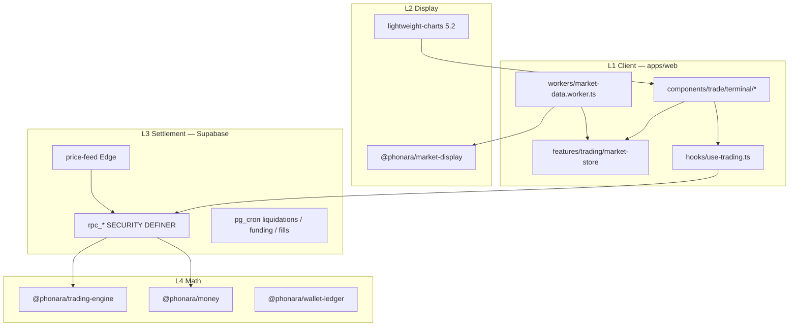

# PHONARA Trade — 30년 아키텍처 정본

> Operator 검증용 요약. 상세 실행 큐·레포 플레이북: Cursor plan `trade_world-class_master_b31b19b6.plan.md`  
> B-book 정본: [`TRADE_MAJORS_BBOOK_RFC.md`](TRADE_MAJORS_BBOOK_RFC.md) · UI testId: [`TRADE_TERMINAL_CEX_SPEC.md`](TRADE_TERMINAL_CEX_SPEC.md)

## 1. 제품 정체성 (한 줄)

**Display(실시간 차트·호가·체결)** ≠ **Settlement(원장·RPC)** — 30년간 이 분리를 깨지 않는다.

| 질문 | 판정 |
|------|------|
| Binance 백엔드 TPS·글로벌 매칭 1위? | **NO** (E4 matcher 전까지) |
| 독단 B-book 30년 운영? | **YES** — ledger·conservation production-grade |
| UI/체감 대형 거래소급? | **YES** — T-RT + terminal 완료 후 |
| Limit/Stop·Cross·Partial? | **YES** — E2·E3 migration green 후 |

PHONARA 모트: 통합 슈퍼앱(Casino+Earn+Trade+Partner) · 한국 UX 밀도 · Worker 60fps · 100% 하우스 마진.

---

## 2. 2-Track · 4-Layer (불변)



### 절대 경계 (위반 = FAIL)

```text
Display WS (Binance/Bybit/OKX public) → market-store → UI only
Oracle (price-feed → oracle_prices) → rpc_* → ledger only
rg: display-chart/** → rpc_open_ | rpc_spot_ | rpc_stake  (0 hit)
UI: number/float로 PnL·청산가·수수료 재계산 금지 — hook/RPC/trading-engine preview only
```

---

## 3. 기술 스택 (고정)

| 영역 | 선택 | 위치 |
|------|------|------|
| Tick state | Zustand 5 + `useSyncExternalStore` | `market-store/` |
| Worker | Comlink 4.4 | `workers/market-data.worker.ts` |
| OB 가상화 | `@tanstack/react-virtual` | `VirtualizedOrderBookPanel` |
| Chart | lightweight-charts 5.2 | `display-chart/` |
| Kline WS | Binance fstream + Bybit v5 | `use-display-kline.ts` |
| Oracle | Edge median | `supabase/functions/price-feed` |
| Money | decimal.js | `@phonara/money` |
| Settlement | PL/pgSQL RPC + pg_cron | `supabase/migrations/` |

신규 패키지 1개: `@phonara/market-display` (React 0 dep).

---

## 4. `/trade` 단일 surface

```text
/trade → TradeLovableSurface → TradeModeShell → TradeTerminalShell
         → spot | futures | staking panels
```

| 금지 (legacy) | 상태 |
|---------------|------|
| `MobileTradeView` | mount 0 |
| `BuyOrderSheet` | `order-ticket/*`로 흡수 |
| `TradeHub` / `TradeEngineBody` | route import 0 |

---

## 5. Settlement 웨이브 (Engine)

| Wave | migration | RPC·기능 | SQL test |
|------|-----------|----------|----------|
| **Majors** | `20260620000128`–`130` | Tier-1 futures · spot holdings · staking | majors conservation |
| **E1** | `20260620000131` | funding · SL/TP cron · margin_mode | `trade_sltp_trigger` · funding |
| **E2** | `20260620000133` | `trading_open_orders` · place/cancel/fill · cron worker | `trade_open_orders_conservation` |
| **E3** | `20260620000134` | cross margin pool · adjust · partial close | `trade_cross_margin` |
| **E4** | (scale trigger) | matcher · Redis Streams | operator 「매칭 GO」 후만 |

UI wire: `use-trading.ts` → `useFuturesTerminalWire` → `FuturesOrderTicketForm` / `TradeBottomDock` / positions card.

---

## 6. 30년 로드맵

| 기간 | 목표 | 핵심 |
|------|------|------|
| **Y0 (2026 H2)** | CEX 체감 + B-book | E1·RT·UI·T-QA · SL/TP live |
| **Y1 (2027)** | CEX 기능 95% | E2 limit/stop 실체결 · Dock 실데이터 |
| **Y2 (2028)** | 마진 완성 | E3 cross · partial · adjust |
| **Y3–5** | 규모·MM | E4 matcher + MM bot |
| **Y5–10** | 다자산 | portfolio margin · options display |
| **Y10–30** | 모듈 교체 | Display/Settlement 분리 → 엔진 교체 without UI rewrite |

L1 Display는 public WS + LWC 업그레이드만 follow. L3 Settlement는 RPC 버전링 (`rpc_*_v2`).

---

## 7. 성능 SLO

| ID | SLO |
|----|-----|
| SLO-1 | Main thread Long Task p95 <200ms @ 100 tick/s |
| SLO-2 | OB scroll 60fps |
| SLO-3 | `rpc_open_futures_position` p99 <150ms local |
| SLO-4 | WS reconnect <2s |
| SLO-5 | 1 viewport = 1 depth WS + 1 kline WS |
| SLO-6 | Mobile hidden → WS 0 within 500ms |
| SLO-7 | conservation Σ=0 every money RPC |

---

## 8. 테스트·마감 게이트 (T-CLOSE)

| Layer | Gate |
|-------|------|
| UI | `typecheck` · `check:i18n` · `check:release` |
| 무결성 | T-QA-0 dedup rg 0 · T-QA-IX E2E matrix |
| Display | vitest `@phonara/market-display` |
| Engine | `supabase db reset` · SQL conservation |
| E2E | `core-flow` futures · `trade-terminal-interaction` · `group-d` oracle |
| RC | `check:full` foreground 1회 (E2E 55+/58 안정 후) |

**T-CLOSE FAIL =** `futures-open`/`futures-close` E2E red · `check:release` red · legacy `/trade` mount 1건+

---

## 9. §GREEN self-check

```bash
# Display → Settlement 경계
rg "rpc_open_|rpc_spot_|rpc_stake" apps/web/src/features/trading/display-chart
# 기대: 0 hit

# Legacy surface
rg "MobileTradeView|BuyOrderSheet|TradeEngineBody|TradeHub" apps/web/src/presentation-import/pages/trade-page.tsx apps/web/src/components/trade
# 기대: import/mount 0 (정의 파일만 허용 시 rg 범위 조정)

# Money float
rg "parseFloat|Number\(" apps/web/src/components/trade/terminal apps/web/src/features/trading/order-ticket
# 기대: 0 hit (표시 format 유틸 제외)

bun run typecheck
bun run check:i18n
bun run check:release
bun run test:e2e
```

---

## 10. 교차 참조

| 문서 | 용도 |
|------|------|
| [`TRADE_MAJORS_BBOOK_RFC.md`](TRADE_MAJORS_BBOOK_RFC.md) | B-book · oracle · catalog |
| [`TRADE_TERMINAL_CEX_SPEC.md`](TRADE_TERMINAL_CEX_SPEC.md) | Hybrid UI · testId |
| [`TRADE_MAJORS_ADMIN_RUNBOOK.md`](TRADE_MAJORS_ADMIN_RUNBOOK.md) | Operator admin |
| `.cursor/plans/trade_world-class_master_b31b19b6.plan.md` | 실행 큐 §K · 레포 플레이북 §J |

---

*갱신: 2026-06-20 · T-CLOSE 산출물*
