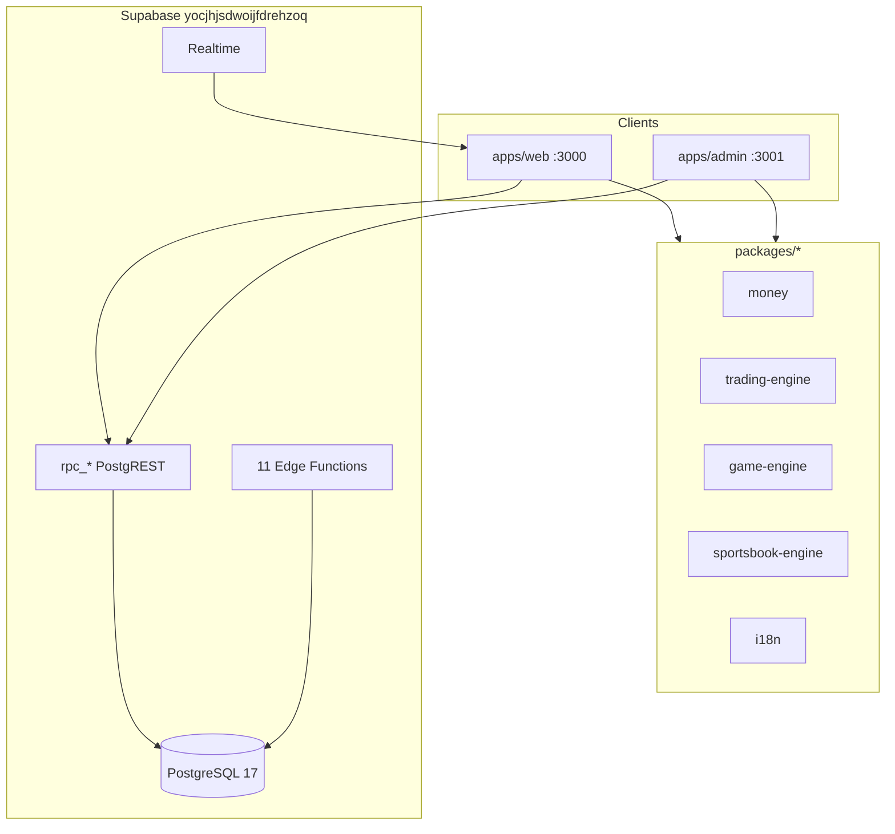

<!-- Generated from Master Project Inventory Audit plan · 2026-07-13 · do not treat as Plan YAML -->

> **정본:** Phase 1 Repository Inventory · 감사 기준일 2026-07-13  
> **부록:** [REPO_TREE_APPENDIX.txt](./REPO_TREE_APPENDIX.txt) · [KNIP_DEADCODE_REPORT.md](./KNIP_DEADCODE_REPORT.md) · [RPC_USAGE_MATRIX.md](./RPC_USAGE_MATRIX.md) · [PER_PAGE_UI_MATRIX.md](./PER_PAGE_UI_MATRIX.md)  
> **재생성:** `bun run scripts/audit/generate-repo-tree-appendix.ts` · `generate-rpc-usage-matrix.ts` · `generate-per-page-ui-matrix.ts` · `bunx knip`

# PHONARA Audit Program

**Phase 1:** Master Project Inventory Audit (본 문서)  
**Phase 2:** World-Class Quality Audit — Plan 문서 하단 (본 export는 §1–§25 Inventory만)

**감사 기준일:** 2026-07-13  
**증거 범위:** 로컬 git 워킹트리 (`c:\Users\PC\Desktop\phonara-gb`)  
**제외:** `node_modules/`, `dist/`, 원격 Supabase 적용 상태, 프로덕션 런타임 동작

---

## 1. Executive Summary

PHONARA는 **Bun workspaces 모노레포**로, **React 19 + Vite 8 + TanStack Router/Query + Tailwind 4 + TypeScript 6** 프론트엔드 2개(`apps/web`, `apps/admin`)와 **9개 엔진 패키지**, **Supabase(PostgreSQL 17) 백엔드**로 구성됩니다. 엔진은 [`docs/ENGINE_APEX_CLOSEOUT.md`](../ENGINE_APEX_CLOSEOUT.md) 기준 **FULLY CLOSED**이며, 현재 구현 큐는 **Phase R UI 재구축**([`docs/SSOT/ACTIVE_WORK_SSOT.md`](../SSOT/ACTIVE_WORK_SSOT.md), [`docs/PRODUCT/REBUILD_PLAN_v1.md`](../PRODUCT/REBUILD_PLAN_v1.md))입니다.

| 차원 | 검증된 사실 |
|------|------------|
| 저장소 유형 | 모노레포 (`apps/*`, `packages/*`) |
| 패키지 매니저 | Bun (`bun --filter`) — Turbo/pnpm **미사용** |
| 트리 부록 파일 수 | **2,833** files · **310** dirs (maxDepth 6, gitignore급 제외) — [REPO_TREE_APPENDIX.txt](./REPO_TREE_APPENDIX.txt) |
| Web 라우트 | **93** route 파일 + `__root.tsx` |
| Web 페이지 | **77** `*-page.tsx` + **2** shells (`casino-game-shell`, `trade-desk-page-shell`) = **79** — [PER_PAGE_UI_MATRIX.md](./PER_PAGE_UI_MATRIX.md) |
| Admin 라우트/페이지 | **34** routes → **32** desk surfaces |
| Types `rpc_*` | **256** · apps 호출 **144** · unused-in-apps **112** — [RPC_USAGE_MATRIX.md](./RPC_USAGE_MATRIX.md) |
| DB 마이그레이션 | **239** SQL files |
| SQL 통합 테스트 | **142** files |
| Vitest | **~644** test files |
| Playwright E2E | **5** specs + **1** smoke |
| Edge Functions | **11** (`supabase/functions/*/index.ts`) |
| 배포 | Cloudflare Pages (`wrangler.toml`, `wrangler.admin.toml`) |
| Knip unused files | **3** — [KNIP_DEADCODE_REPORT.md](./KNIP_DEADCODE_REPORT.md) |

**핵심 아키텍처:**



---

## 2. Repository Overview

### 2.1 메타데이터

| 항목 | 값 | 근거 |
|------|-----|------|
| 이름 | `phonara-gb` v0.1.0 | [`package.json`](package.json) |
| 타입 | private ESM monorepo | `package.json` `"type":"module"` |
| 런타임 | Bun (scripts), Node-compatible TS | `package.json` scripts |
| 언어 | TypeScript, SQL, PowerShell(ops) | 파일 확장자 분포 |

### 2.2 Workspace 의존 그래프

```
phonara-gb (root)
├── apps/web (@phonara/web)
│   └── depends: @phonara/* packages, @supabase/supabase-js, tanstack, zustand, pixi.js, lightweight-charts
├── apps/admin (@phonara/admin)
│   └── depends: @phonara/*, web primitives/tokens via Vite alias
└── packages/
    ├── shared-types (generated database.types.ts)
    ├── money, wallet-ledger
    ├── trading-engine, game-engine, sportsbook-engine, sports-ingest, market-display
    └── i18n (ko/en)
```

### 2.3 폴더 구조 (최상위 — active/generated 표기)

| 경로 | 상태 | 역할 |
|------|------|------|
| [`apps/web/`](apps/web/) | **active** | 사용자 PWA SPA |
| [`apps/admin/`](apps/admin/) | **active** | 운영자 Admin SPA |
| [`packages/`](packages/) | **active** | 엔진·i18n·타입 (frozen) |
| [`supabase/`](supabase/) | **active** | migrations, tests, functions |
| [`scripts/`](scripts/) | **active** | gates, deploy, ops (~353 files) |
| [`tests/`](tests/) | **test** | E2E, integration, script tests |
| [`docs/`](docs/) | **active** | SSOT, operations, audit evidence |
| [`.cursor/`](.cursor/) | **config** | rules, hooks, skills |
| [`.github/workflows/`](.github/workflows/) | **config** | CI |
| [`screenshots/`](screenshots/) | **test/assets** | visual audit placeholders |
| `apps/web/src/components/ui/` | **deprecated/deleted** | 0 files (v5 Demolition) |
| `apps/web/src/presentation-import/` | **deprecated/deleted** | 0 files |
| `packages/ui/` | **deprecated/deleted** | 0 files |
| `apps/*/dist/`, `packages/*/dist/` | **generated** | build output (gitignored) |
| `test-results/`, `playwright-report/` | **temporary** | E2E residue |

**Verified appendix:** 전체 폴더 트리(maxDepth 6) — [REPO_TREE_APPENDIX.txt](./REPO_TREE_APPENDIX.txt) · machine-readable [REPO_TREE_APPENDIX.json](./REPO_TREE_APPENDIX.json) (dirs=310 · files=2,833). 아래는 핵심 2~4 depth 요약 트리입니다.

```
phonara-gb/
├── apps/
│   ├── web/src/
│   │   ├── routes/          [93 files — TanStack file routes]
│   │   ├── product/
│   │   │   ├── shell/       [AppShell, BottomNav, PwaShell]
│   │   │   ├── surfaces/    [27 domain folders, 308 tsx]
│   │   │   ├── primitives/  [Phase R design system, 63 files]
│   │   │   ├── tokens/      [CSS token SOT]
│   │   │   └── routing/     [redirect registry]
│   │   ├── features/        [17 modules, ~298 files]
│   │   ├── domain/          [196 display-contracts]
│   │   ├── hooks/           [engine glue whitelist]
│   │   ├── stores/          [zustand x2 + notifications]
│   │   └── contexts/        [auth, PWA install]
│   └── admin/src/
│       ├── routes/          [34 files]
│       ├── product/surfaces/ [32 admin-*-page.tsx]
│       ├── hooks/admin/     [desk hooks]
│       └── domain/          [20 admin contracts]
├── packages/ [9 workspaces]
├── supabase/
│   ├── migrations/ [239]
│   ├── tests/ [142]
│   └── functions/ [11 edge functions]
├── scripts/ [lib/, pentest/, sports-*, audit/, check/]
├── tests/e2e/ [5 specs]
└── docs/ [SSOT/, OPERATIONS/, PRODUCT/, audit/]
```

---

## 3. Technology Stack (검증됨)

| 계층 | 기술 |
|------|------|
| UI | React 19.2.7, Radix UI primitives, lucide-react, motion |
| Routing | TanStack Router ~1.170 (file-based) |
| Data fetching | TanStack Query 5.x, typed `callRpc` wrapper |
| CSS | Tailwind CSS 4 + `@tailwindcss/vite`, custom `--ds-*` tokens |
| Forms | react-hook-form, zod |
| Charts/Games | lightweight-charts 5, Pixi.js 8 |
| PWA | vite-plugin-pwa, workbox-window |
| State (global) | Zustand 5 (3 files only), React Context (auth, PWA) |
| Money | decimal.js via `@phonara/money` |
| Backend | Supabase JS 2.x, PostgreSQL 17 |
| Auth | Supabase Auth (session JWT), SIWE edge function |
| Realtime | Supabase Realtime channels (`use-realtime.ts`, sports/trade/casino hooks) |
| Deploy | Cloudflare Pages + Wrangler 4 |
| Test | Vitest 4, Playwright 1.60, SQL integration |
| Lint/Dead code | ESLint 10, Prettier 3, Knip 6 (`knip.json`) |
| CI | GitHub Actions (`quality`, `sql`, `e2e`, `advisors`) |

**미사용/부재 (코드 검색 기준):** Next.js, NestJS, Redux, GraphQL client, Redis client, Webpack, Turbo, pnpm.

---

## 4. Route Inventory

### 4.1 Web — 5-tab IA + account/marketing/legal

**BottomNav (5 tabs)** — [`apps/web/src/product/shell/bottom-nav.tsx`](apps/web/src/product/shell/bottom-nav.tsx):

| Tab | Route | Domain |
|-----|-------|--------|
| Earn | `/home` | earn |
| Wallet | `/wallet` | wallet |
| Trade | `/trade` | trade |
| Sports | `/sports` | sports |
| Casino | `/casino` | casino |

**Shell hierarchy** — [`apps/web/src/routes/__root.tsx`](apps/web/src/routes/__root.tsx):

```
AuthProvider → PwaShell → [AppShell | MarketingShell | ContentShell] → <Outlet/>
```

**총 canonical paths:** ~90 (from `routeTree.gen.ts` `FileRoutesByTo`)

**Auth model:** 대부분 `beforeLoad` + `getSession()` → `/login` redirect. Public: `/`, auth funnel, `/legal/*`, marketing trust pages. **예외:** `/support/ticket` — MarketingShell이지만 auth required.

**Legacy redirects** — [`apps/web/src/product/routing/resolve-route-redirect.ts`](apps/web/src/product/routing/resolve-route-redirect.ts): `/earn`→`/home`, `/deposit`→`/wallet/deposit`, `/betting`→`/sports` 등.

**Nested layouts (Outlet 있음):** `/wallet`, `/wallet/deposit`, `/wallet/withdraw`, `/trade`, `/sports`, `/casino`, `/onboarding`

**Dynamic routes:**
- `/games/$gameCode` — 12 casino slugs (surface-domain-boundary.ts)
- `/sports/fixture/$fixtureId`
- `/r/$code` — referral redirect → signup

### 4.2 Admin — RBAC-filtered sidebar

**Nav SOT:** [`apps/admin/src/product/layout/admin-nav.tsx`](apps/admin/src/product/layout/admin-nav.tsx)

| Route | Surface |
|-------|---------|
| `/` | admin-home |
| `/queues`, `/deposits`, `/withdrawals`, `/sports` | queue desks |
| `/earn/*` (4 children) | earn desks |
| `/users`, `/users/$userId/tier` | user management |
| `/tiers`, `/tier-benefits`, `/promotions`, `/cms` | growth/content |
| `/casino`, `/risk`, `/staking`, `/audit` | ops desks |
| `/settings`, `/team`, `/support` | config |
| `/mfa/*`, `/ops` | security/ops |
| `/login` | auth (no AdminShell) |

**Redirect aliases:** `/config`→`/settings`, `/rewards`→`/earn/rewards`, `/audit-logs`→`/audit`

---

## 5. Page Inventory (요약 매트릭스)

**Web (실측 2026-07-13):** 77 `*-page.tsx` + `casino-game-shell.tsx` + `trade-desk-page-shell.tsx` = **79** surfaces. **Admin:** 32 `admin-*-page.tsx`.  
(Plan 초안 “81 pages”는 근사치 — 본 표·부록이 정본.)

| Domain | Pages | Representative routes | API pattern |
|--------|------:|------------------------|-------------|
| Earn/Home | 14 | `/home`, `/referral`, `/staking` | `rpc_*` via feature controllers + TanStack Query |
| Wallet | 12 | `/wallet`, `/wallet/deposit/*`, `/ledger` | wallet RPCs, realtime ledger |
| Trade | 4 + desk shell | `/trade`, `/trade/futures` | spot/futures RPCs, market stores |
| Sports | 1 surface × 7 routes | `/sports/*` | `sports-page.tsx` shared |
| Casino | 2 + game shell | `/casino`, `/games/$gameCode` | provably-fair RPCs, Pixi stages |
| Account/Settings | 13 | `/account/*`, `/settings/*` | profile, KYC, API keys |
| Marketing/Legal | 20+ | `/`, `/features`, `/legal/*` | mostly static + CMS reads |
| Admin | 32 | all `/admin` routes | `useAdmin*Desk` hooks |

**Per-page UI states (static contract scan):** 전체 표 — [PER_PAGE_UI_MATRIX.md](./PER_PAGE_UI_MATRIX.md)

| State | yes | partial | no |
|-------|----:|--------:|---:|
| Loading | 56 | (see matrix) | (see matrix) |
| Empty | 31 | | |
| Error | 48 | | |
| Responsive (`md:`/`lg:`/`sm:` in page) | 57 | | |

각 surface는 `*-display-contract.ts` + vitest로 **표시 계약**이 정의됨 (196 web contracts).  
**NOT VERIFIED:** 실제 브라우저 렌더링·애니메이션·axe a11y 점수 — CI E2E 5 spec만 부분 커버.

---

## 6. Navigation Audit

### Web

| Nav type | Owner file | Items |
|----------|-----------|-------|
| BottomNav | `bottom-nav.tsx` | 5 tabs (Earn/Wallet/Trade/Sports/Casino) |
| TopBar | `top-bar.tsx` | brand, notifications, account avatar |
| Earn subnav | `earn-shell.tsx` | desktop side nav + mobile subnav |
| Domain subnav | `trade-subnav`, `sports-subnav`, `casino-subnav`, `wallet-subnav` registries | horizontal mobile subnav |
| Profile/Settings | settings hub routes | 7 settings children |

### Admin

| Nav type | File | Notes |
|----------|------|-------|
| Sidebar | `admin-nav.tsx` | 17 top-level + Earn group (5 children) |
| Mobile quick nav | `MOBILE_QUICK_NAV` | 8 flat items |
| RBAC filter | `admin-nav-filter.ts` | role-based visibility |

**NOT VERIFIED:** Footer nav, context menus 전수 (코드에 산재 — primitives `dropdown-menu.tsx` 존재).

---

## 7. Component Inventory

### 7.1 Design System Primitives (Phase R SOT)

**Export barrel:** [`apps/web/src/product/primitives/index.ts`](apps/web/src/product/primitives/index.ts)

| Category | Components |
|----------|------------|
| Actions | Button, IconButton, ConfirmDialog |
| Layout | Card (+Header/Body/Footer), Sheet, Dialog |
| Forms | Input, Field, Select, Switch, Slider, SpendCurrencySelector |
| Feedback | ToastZone, StatusBadge, ErrorPanel, Skeleton, EmptyState, ZeroBalanceState |
| Data display | MoneyDisplay, MoneyDisplayWithFiatHint, Text, ProgressRing |
| Navigation | Tabs, DropdownMenu, Popover, Tooltip |
| Domain | MissionCard, RoutineCard, HowItWorks, BrandMark, QuadStreamLoading |

**Admin override:** `admin-table.tsx` (admin-local primitive)

### 7.2 Surface components (web)

- **308** `.tsx` under `apps/web/src/product/surfaces/` (pages + panels + game stages + tests)
- Game stages: `crash-stage`, `plinko-stage`, `mines-stage`, `hilo-stage`, `gold-rush-stage`, etc. under `surfaces/games/`

### 7.3 Feature controllers/hooks

- **183** `use-*.ts` files in `apps/web/src`
- **17** feature modules under `features/`

### 7.4 Domain contracts (not UI components)

- **196** `*-display-contract.ts` in `apps/web/src/domain/`
- **20** admin domain contracts

---

## 8. Design System Inventory

**SOT:** [`apps/web/src/product/tokens/index.css`](apps/web/src/product/tokens/index.css)

| Token file | Contents |
|------------|----------|
| `fonts.css` | Typography faces |
| `colors.css` | Color tokens |
| `spacing.css` | Spacing scale |
| `elevation.css`, `brand-elevation.css` | Shadows/elevation |
| `domain-card-personalities.css` | Per-domain card variants |
| `signature-surfaces.css` | Brand signature surfaces |
| `layout.css` | Shell layout tokens |
| `motion.css` + `motion.ts` | Animation presets |
| `theme.css` | Tailwind v4 bridge |
| `shell.css`, `shell-chrome.css`, `marketing-shell.css` | Chrome |

**Icons:** lucide-react (runtime), brand SVGs in `apps/web/public/brand/`  
**Dark/Light:** `theme-shell.tsx` + persisted theme contract  
**Charts:** lightweight-charts (trade), Pixi canvas (casino)

**삭제됨 (verified absent):** `theme.css` (old path), `@phonara/ui`, `components/ui`

---

## 9. Feature Inventory (구현 상태 분류)

| Feature | Status | Evidence |
|---------|--------|----------|
| Auth (login/signup/reset/verify/SIWE) | **Complete** | routes + controllers + SQL tests |
| Wallet (KRW/crypto/giftcard deposit/withdraw) | **Complete** | wallet surfaces + `phase5_*` SQL tests |
| Spot/Futures trading | **Complete** | trade surfaces + `trade_*` SQL tests |
| Staking | **Complete** | staking surfaces + `staking_conservation_test.sql` |
| Sportsbook | **Complete** | sports surfaces + `sportsbook_*` SQL tests (20+ files) |
| Casino (12 games + provably fair) | **Complete** | game stages + `casino_*` SQL tests |
| Earn/Missions/Referral/Tier | **Complete** | earn features + `mission_*`, `referral_*` tests |
| Admin desks | **Complete** | 32 surfaces + `admin_*` SQL tests |
| PWA install | **Partial** | `install-page.tsx`, `check:pwa` gate |
| Sports VIP panel | **Stub** | `sports-vip-stub-panel.tsx` (filename evidence) |
| Landing logged-in redirect | **NOT VERIFIED** | route comment only |

---

## 10. Database Inventory

**Types SOT:** [`packages/shared-types/src/database.types.ts`](packages/shared-types/src/database.types.ts) (generated, do not edit)

| Object | Count | Method |
|--------|------:|--------|
| Tables (`public.Tables`) | **~136** | Manual enumeration from types file (admin_review_queue … withdrawal_requests) |
| Views | **4** | `casino_game_rtp_stats`, `v_game_bets_client`, `v_game_rounds_public`, `v_user_consent_latest` |
| Enums | **~30+** | `Database["public"]["Enums"]` block (currency, game_code, admin_role, etc.) |
| Client `rpc_*` in types | **256** | [RPC_USAGE_MATRIX.md](./RPC_USAGE_MATRIX.md) |
| Internal `_*` helpers | **many** | revoked from anon per migration policy |
| Migrations | **239** | `supabase/migrations/*.sql` |
| SQL integration tests | **142** | `supabase/tests/*.sql` |
| Seed data | **NOT VERIFIED** | no dedicated seed dir found; tests use inline setup |

**Remote applied state / live row counts:** **NOT VERIFIED**

---

## 11. API Inventory

| Type | Implementation |
|------|----------------|
| REST | Supabase PostgREST (auto from `public` schema) |
| RPC | Typed `callRpc` in [`apps/web/src/lib/rpc.ts`](apps/web/src/lib/rpc.ts), `useRpc` hook |
| GraphQL | `graphql_public` schema stub in types — **no client usage verified** |
| Edge Functions | 11 Deno functions (crypto, price-feed, siwe-auth, webhooks, analytics) |
| Server Actions | **None** (SPA, not Next.js) |

**Auth:** Supabase JWT session; Admin MFA step-up (`mfa/*` routes)  
**Rate limiting:** `rpc_rate_limit_buckets`, `rpc_rate_limit_configs` tables  
**Validation:** zod (client), SQL guards (server)

---

## 12. State Management

| Mechanism | Usage |
|-----------|-------|
| TanStack Query | Primary — all desk data, `useRpc` mutations |
| Zustand | 3 files: `stores/realtime.ts`, `stores/notifications.ts`, `casino-fiat-rate-session.ts` |
| React Context | `auth-context.tsx` (web+admin), `install-prompt-context.tsx` |
| Custom pub/sub | `ticker-store.ts`, `order-book-store.ts` (trade market display) |
| Session/Cookies | Supabase auth session — **NOT VERIFIED** cookie names without runtime |

---

## 13. Realtime

| Channel | Evidence files |
|---------|---------------|
| Supabase Realtime | `hooks/use-realtime.ts`, `stores/realtime.ts` |
| Trade oracle/ticker | `use-trade-oracle-realtime-disconnected.ts`, `ticker-store.ts` |
| Sports odds | `use-sports-realtime.ts`, `sports-realtime-cache.ts` |
| Casino live crash | `use-live-crash.ts`, `use-progressive-round.ts` |
| Wallet ledger | `wallet-ledger-realtime-display-contract.ts` |

**SSE / custom WebSocket / Message Queue:** **NOT VERIFIED** in client code.

---

## 14. Security Inventory

| Control | Status |
|---------|--------|
| JWT (Supabase) | Implemented — `auth-context.tsx` |
| RBAC (Admin) | `admin-rbac.ts`, `useAdminOperatorRbac.ts`, `admin_role_grants` table |
| RLS | 239 migrations, `grants_rls_inventory_test.sql` |
| Service role isolation | Rules forbid `VITE_*` service key |
| MFA | Admin `/mfa/*`, `admin_mfa_aal2_test.sql` |
| SIWE | Edge function `siwe-auth` |
| HIBP | Feature flag migration `h09_r3e_*` |
| CSRF/XSS/SQLi | **NOT VERIFIED** at runtime; SQL parameterized RPCs + RLS at DB layer |
| Secrets | `.env.example` template — actual secrets **NOT VERIFIED** |

---

## 15. Performance Inventory

| Technique | Evidence |
|-----------|----------|
| Code splitting | Vite dynamic imports in routes (TanStack Router lazy) — **partial, NOT VERIFIED per-route** |
| Lazy loading | `React.lazy` usage — grep needed per bundle; **NOT VERIFIED exhaustive** |
| Memoization | React Compiler babel plugin in web `package.json` |
| PWA caching | `vite-plugin-pwa`, `apps/web/src/sw.ts` |
| Virtualization | **NOT VERIFIED** |
| Bundle strategy | Vite 8 production build, `build:web:production` script |
| Trade perf E2E | `trade-desk-perf.spec.ts` |

---

## 16. Testing Inventory

| Layer | Count | Runner |
|-------|------:|--------|
| Vitest unit/integration | ~644 | `vitest.config.ts` (maxWorkers: 1) |
| SQL integration | 142 | `scripts/run-sql-tests.ts` |
| Playwright E2E | 5 + 1 smoke | `playwright.config.ts` |
| Display contracts | 196+20 | vitest in `domain/__tests__/` |
| CI required jobs | 4 | quality, sql, e2e, advisors |
| Coverage | optional | `test:coverage` script |
| Visual/pixel | legacy demoted | screenshots/ placeholders |

**Engine gate:** `test:engine` — packages only (275/275 per closeout doc; current count **NOT VERIFIED** this session)

---

## 17. Assets Inventory

| Type | Count (apps/) | Location |
|------|-------------:|----------|
| PNG (PWA/splash/screenshots) | ~35 | `apps/web/public/` |
| SVG (brand/concepts) | ~25 | `apps/web/public/brand/` |
| Fonts | **NOT VERIFIED** in public/ | likely `fonts.css` CDN/local |
| i18n catalogs | 2 locales | `presentation-ko.ts`, `presentation-en.ts` |
| Lottie/Video/Audio | **0 found** in apps glob |

---

## 18. Documentation Inventory

| Category | Files | Key paths |
|----------|------:|-----------|
| SSOT | 31 | `docs/SSOT/ACTIVE_WORK_SSOT.md`, UX canons |
| Operations/Audit | ~210 | `docs/OPERATIONS/PLATFORM_AUDIT_*` |
| Product plans | 31 | `REBUILD_PLAN_v1.md`, `DEMOLITION_PLAN.md` |
| Engine closeout | 1 | `ENGINE_APEX_CLOSEOUT.md` |
| ADR | 15+ | `docs/PRODUCT/ADR/`, `docs/ADR/` |
| Audit reports | 14 | `docs/audit/` |
| Index | 1 | `docs/DOCS_INDEX.md` |
| **Total docs/** | **311** | |

---

## 19. Duplicate Detection Register

| Type | Finding | Evidence |
|------|---------|----------|
| Parallel UI paths | **None active** | `components/ui`, `presentation-import` deleted |
| Duplicate pages | **1 candidate** | `spot-desk-page.tsx` appears twice in git status (path casing) — verify on disk |
| Sports routes → 1 surface | **Intentional** | 7 routes share `sports-page.tsx` |
| Admin table dedup | Contract exists | `admin-table-dedup-display-contract.ts` |
| Trade layout dedup | Contract exists | `trade-layout-dedup-display-contract.ts` |
| Full duplicate scan | **Partial** | Knip duplicate exports **7** — [KNIP_DEADCODE_REPORT.md](./KNIP_DEADCODE_REPORT.md) |

---

## 20. Dead Code Register

| Category | Status |
|----------|--------|
| Pre-demolition UI | **Deleted** — verified 0 files |
| Knip dead-code report | **Verified** — [KNIP_DEADCODE_REPORT.md](./KNIP_DEADCODE_REPORT.md) · raw [knip-raw-output.txt](./knip-raw-output.txt) |
| Unused files (Knip) | **3** — `admin-desk-views.ts`, `controller-view-freeze.ts`, `admin/lib/i18n.tsx` |
| Unused exports / types | **17** / **10** (engine/ingest helpers · web `lib/i18n` re-exports) |
| Unused routes | **No unused route files flagged** (TanStack entry graph) |
| Unused RPCs (apps static) | **112** types `rpc_*` with **no** web/admin call site — [RPC_USAGE_MATRIX.md](./RPC_USAGE_MATRIX.md) (Edge/SQL/cron may still use) |

---

## 21. Missing Feature Register

Items referenced in docs/rules but not fully verifiable in code:

| Item | Status |
|------|--------|
| `@phonara/ui` shared package | **Missing by design** (Phase R TBD) |
| Full 58 E2E spec suite | **Partial** — 5 specs on disk; CI may run more via config |
| zh/ja i18n locales | **Not implemented** — ko/en only |
| Remote migration parity | **NOT VERIFIED** without `stack:push-remote` / MCP list |

---

## 22. Production Readiness Summary

| Gate | Local evidence | Authoritative |
|------|---------------|---------------|
| typecheck/lint/format | scripts exist | CI `quality` |
| check:release | script exists | CI `quality` |
| test:sql Σ=0 | 142 tests exist | CI `sql` |
| test:e2e | 5 specs | CI `e2e` |
| advisors 0 ERROR | script exists | CI `advisors` |
| Engine CLOSED | `ENGINE_APEX_CLOSEOUT.md` | frozen — no new migrations intended |
| Phase R UI | ACTIVE_WORK_SSOT | in progress |
| Platform audit R1–R12 | docs/OPERATIONS evidence | operator signoff templates exist |

**Overall:** Engine/money paths are production-hardened per closeout + SQL tests. UI is Phase R rebuild with broad vitest contract coverage; full browser matrix and visual signoff are **operator/CI authoritative**, not verified in this read-only pass.

---

## 23. Project Statistics (verified counts)

| Metric | Count |
|--------|------:|
| Total tracked files (glob) | ~1,994 |
| Top-level workspaces | 12 package.json |
| Web route files | 93 |
| Web page components | 77 + 2 shells (79) |
| Admin route files | 34 |
| Admin page surfaces | 32 |
| Web surface tsx files | 308 |
| Primitives files | 63 |
| Feature modules (web) | 17 |
| use-* hooks (web) | 183 |
| Display contracts (web) | 196 |
| DB tables (types) | ~136 |
| DB views (types) | 4 |
| Types `rpc_*` | 256 (apps used 144) |
| Migrations | 239 |
| SQL tests | 142 |
| Edge functions | 11 |
| Vitest files | ~644 |
| E2E specs | 5 (+1 smoke) |
| Docs files | 311 |
| Scripts files | 353 |
| Public assets (apps) | 64 |
| i18n locales | 2 |
| Tree appendix files (depth≤6) | 2,833 |

---

## 24. Deliverable Artifacts

본 문서 + 부록으로 **exported / generated** (2026-07-13):

| # | Artifact | Path |
|---|----------|------|
| 1–23 | Inventory sections §1–§23 | 본 파일 |
| Tree | Machine-readable folder tree | [REPO_TREE_APPENDIX.txt](./REPO_TREE_APPENDIX.txt) · [.json](./REPO_TREE_APPENDIX.json) |
| Dead code | Knip report | [KNIP_DEADCODE_REPORT.md](./KNIP_DEADCODE_REPORT.md) |
| RPC | Types ↔ apps matrix | [RPC_USAGE_MATRIX.md](./RPC_USAGE_MATRIX.md) |
| UI states | 79 web surfaces loading/empty/error/responsive | [PER_PAGE_UI_MATRIX.md](./PER_PAGE_UI_MATRIX.md) |

Generators: `scripts/audit/generate-repo-tree-appendix.ts` · `generate-rpc-usage-matrix.ts` · `generate-per-page-ui-matrix.ts`

---

## 25. Verification Limits (명시적 NOT VERIFIED)

다음은 **본 감사에서 의도적으로 검증하지 않음**:

- 원격 Supabase migration 적용 상태 및 live advisor
- 프로덕션 Cloudflare Pages 배포 URL 동작
- 모든 페이지의 **실제 브라우저** responsive/animation/a11y 상태 (정적 매트릭스만 완료)
- Knip `devDependencies` / OS binary false-positive 삭제 적격성 (보고만)
- `node_modules` 및 gitignored `dist/` 내부
- Operator 브라우저 수동 증거 (PLATFORM_AUDIT R* templates)

**재현 명령:**

```powershell
bun run scripts/audit/generate-repo-tree-appendix.ts
bun run scripts/audit/generate-rpc-usage-matrix.ts
bun run scripts/audit/generate-per-page-ui-matrix.ts
bunx knip --no-progress
bun run typecheck
```

---

